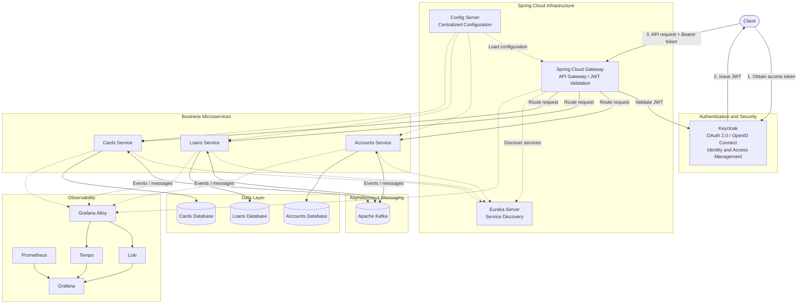

# SammoBank Microservices

### SammoBank is a banking application built using Spring Boot and Spring Cloud, demonstrating a microservices architecture with centralized configuration, service discovery, API gateway routing, inter-service communication, asynchronous messaging, security, observability, containerization, and CI/CD.
### The application consists of independently buildable services for Accounts, Loans, and Cards, supported by infrastructure services such as Eureka Service Discovery, Spring Cloud Config Server, and Spring Cloud Gateway.
Docker Compose and Helm configurations are provided for multiple environments. The Docker Compose default configuration and Helm dev-env configuration represent the local development setup and have been validated. The QA and production configurations are also included but may require further updates and validation.

## Architecture

### SammoBank follows a microservices architecture built with Spring Boot and Spring Cloud. The system separates business services from infrastructure components for routing, authentication, service discovery, centralized configuration, and asynchronous messaging.

### High-Level Architecture


### Core Components
| Component | Responsibility |
|---|---|
| **Spring Cloud Gateway** | Provides a single entry point for API requests and routes them to the appropriate service. |
| **Keycloak** | Manages identities and access tokens using OAuth 2.0 and OpenID Connect. |
| **Eureka Server** | Enables service registration and discovery. |
| **Config Server** | Centralizes external configuration for application services. |
| **Accounts Service** | Handles account-related business operations. |
| **Loans Service** | Handles loan-related business operations. |
| **Cards Service** | Handles card-related business operations. |
| **Apache Kafka** | Supports asynchronous communication through messages and events. |
| **Databases** | Persist business data for the respective services. |
| **Observability Stack** | Collects and visualizes application telemetry, logs, metrics, and traces. |

### Request and Communication Flow
1. The client authenticates with Keycloak and obtains an access token.
2. The client sends API requests to Spring Cloud Gateway with the token.
3. The gateway validates the JWT and routes requests to the appropriate business service.
4. Eureka provides service discovery, while Config Server supplies external configuration.
5. Services communicate synchronously where required and use Kafka for asynchronous messaging where configured.
6. Each business service accesses its associated database.
7. Observability components collect and visualize telemetry from the application and its infrastructure.


## Microservices

### SammoBank consists of three business microservices and four supporting infrastructure services. Each service is maintained as an independent Maven project with its own `pom.xml` and Maven Wrapper.

### Business Services
| Service | Description |
|---|---|
| **Accounts** | Manages account-related business operations. |
| **Loans** | Manages loan-related business operations. |
| **Cards** | Manages card-related business operations. |

### Infrastructure Services
| Service | Description |
|---|---|
| **Gateway Server** | Routes incoming API requests to the appropriate microservice. |
| **Eureka Server** | Provides service registration and discovery. |
| **Config Server** | Provides centralized external configuration to the microservices. |
| **Message** | Handles messaging-related functionality within the application. |

### Project Structure
```text
SammoBank/
├── accounts/
├── loans/
├── cards/
├── gatewayserver/
├── eurekaserver/
├── configserver/
├── message/
├── docker-compose/
├── helm/
├── docker/
└── .github/
    └── workflows/
        └── ci-cd.yml
```
Each service can be built and tested independently using its Maven Wrapper. The repository also contains Docker Compose configurations, Helm deployment configurations, a custom Java base image, and the GitHub Actions CI/CD workflow.

## Technology Stack

### Backend Development
- **Java 25**
- **Spring Boot**
- **Spring Cloud**
- **Spring Data JPA / Hibernate**
- **Spring Boot Actuator**
- **Spring Validation**
- **Springdoc OpenAPI**

### Microservices Infrastructure
- **Spring Cloud Gateway** — API routing
- **Spring Cloud Netflix Eureka** — Service discovery
- **Spring Cloud Config Server** — Centralized configuration
- **OpenFeign** — Declarative inter-service HTTP communication

### Security
- **Keycloak** — Identity and access management
- **OAuth 2.0 / OpenID Connect** — Authentication and authorization protocols
- **JWT** — Token-based security

### Messaging
- **Apache Kafka** — Asynchronous messaging between application components

### Databases
- **MySQL** — Relational data persistence

### Observability
- **Prometheus** — Metrics collection
- **Grafana** — Metrics and telemetry visualization
- **Grafana Loki** — Log aggregation
- **Grafana Alloy** — Telemetry collection and forwarding
- **Grafana Tempo** — Distributed tracing
- **MySQL Exporter** — MySQL metrics collection
- **OpenTelemetry** — Instrumentation and telemetry standards

### Containerization and Deployment
- **Docker** — Containerization
- **Docker Compose** — Local multi-container environment
- **Kubernetes** — Container orchestration
- **Helm** — Kubernetes application packaging and deployment
- **Jib** — Building and publishing Java container images

### CI/CD and Build Tools
- **GitHub Actions** — Automated build, test, and container image publishing
- **Maven** — Dependency management and build automation
- **Maven Wrapper** — Consistent Maven execution across environments
- **Git** — Version control
- **Docker Hub** — Container image registry

## Prerequisites

Ensure the following tools are installed before setting up SammoBank locally.
- **Java 25** — Required for building and running the application.
- **Git** — For cloning the repository.
- **Docker Engine / Docker Desktop** — For running the supporting infrastructure and application containers.
- **Docker Compose** — For starting the local multi-container environment.
- **Kubernetes cluster** — Required when deploying through Helm.
- **Helm 3** — For managing Kubernetes deployments.
- **GitHub account** — Required to access the repository and CI/CD workflow.
- **Docker Hub account** — Required if building and publishing container images to your own registry.

### External Configuration
The Config Server uses an external configuration repository. Ensure that the repository is accessible and that any required credentials are configured before starting the application.
Refer to the [Local Setup](docs/deployment/local-setup.md) guide for environment configuration and startup instructions.

## Getting Started
Follow these steps to start SammoBank using the default Docker Compose configuration.

### 1. Clone the Repository
```powershell
git clone https://github.com/SoyaChunkz/MICROSERVICES.git
cd MICROSERVICES
```

### 2. Start the Application
Navigate to the default Docker Compose directory and start the services:
```powershell
cd docker-compose/default
docker compose up -d
```
Docker Compose starts the application services and their configured infrastructure dependencies in the background.

### 3. Verify the Running Containers
Check the status of the containers:
```powershell
docker compose ps
```
To inspect the logs for all services:
```powershell
docker compose logs -f
```
To view logs for a specific service:
```powershell
docker compose logs -f accounts
```
Replace `accounts` with the relevant Compose service name.

### 4. Stop the Application
To stop and remove the containers created by the Compose configuration:
```powershell
docker compose down
```
Named volumes are retained by default, so persistent data is not removed by this command.

> **Note:** Ensure the required external configuration repository and credentials are available before starting the application. The default configuration is the validated local setup.

## Build and Container Images

Each SammoBank microservice is an independent Maven project with its own Maven Wrapper. Application builds, local container images, Helm deployments, and CI/CD publishing are separate workflows.

### Build and Test a Microservice
From the repository root, navigate to the service directory and run the Maven Wrapper.

For example, to build and test the Accounts service:
```powershell
cd accounts 
.\mvnw.cmd clean verify
```
The `clean verify` command cleans previous build output, compiles the application, runs tests, and executes the Maven verification phase.

The same process can be used for the other services:
- `accounts`
- `cards`
- `loans`
- `gatewayserver`
- `eurekaserver`
- `configserver`
- `message`

### Custom Java Base Image
SammoBank uses a custom Java 25 runtime base image that includes `curl`, which is required by the container health checks.

The Dockerfile is maintained at:

```text
docker/
└── java25-curl/
    └── DockerFIle
```

Build the base image locally from the repository root:
```powershell
docker build -t soyachunkz/java25-curl:latest -f docker/java25-curl/DockerFIle .
```

This creates the `soyachunkz/java25-curl:latest` image locally, which can be used as the base image when building application containers.

The custom base image provides a consistent runtime environment for the application containers.

### Build Application Images Locally
To build an application image for local Docker Compose or Kubernetes use, first build and test the relevant service.

For example, from the repository root:

```powershell
cd accounts
.\mvnw.cmd -DskipTests compile jib:dockerBuild -Dimage=soyachunkz/accounts:latest
```

This uses Jib to build the Accounts container image directly into the local Docker daemon. The image can then be used by Docker Compose or by a local Kubernetes cluster that can access the image.

Repeat the process for the other services by changing the directory and image name.

For example:
```powershell
cd ..\cards
.\mvnw.cmd -DskipTests compile jib:dockerBuild -Dimage=soyachunkz/cards:latest
```

The `compile` phase ensures that application classes are available before Jib builds the image. The `-DskipTests` option skips test execution, so run `clean verify` first when you need to validate the service.

### Docker Compose

Docker Compose runs the application and its supporting infrastructure using the image references defined in the Compose configuration. It does not automatically build application images unless build instructions are configured in the Compose file.

The local workflow is:
1. Build the custom Java base image if needed.
2. Build the required application images locally.
3. Ensure the image names and tags match those referenced in the Compose configuration.
4. Start the environment.

From the repository root, run:
```powershell
cd docker-compose/default
docker compose up -d
```

The `docker-compose/default` configuration is the validated local setup.

### Kubernetes with Helm

Helm manages Kubernetes resources using charts and environment-specific values. It does not build application images, so the required images must be built separately and made accessible to the Kubernetes cluster.

The local workflow is:
1. Build the custom Java base image if needed.
2. Build the required application images.
3. Make the images accessible to the Kubernetes cluster, either by loading them into the local cluster or publishing them to an accessible container registry.
4. Ensure the Helm values reference the correct image names and tags.
5. Install or upgrade the application using Helm.

The validated local Kubernetes configuration is located at:
```text
helm/environments/dev-env/
```

See the deployment documentation for the complete image preparation and Helm installation workflow.

### CI/CD Image Publishing
SammoBank uses [Jib](https://github.com/GoogleContainerTools/jib) in GitHub Actions to build and publish application images to Docker Hub without requiring a local Docker daemon for the image build.

The workflow runs build and test jobs for relevant services and publishes images when the required conditions are met.

Published application images use the following naming convention:
```text
soyachunkz/<service>:<git-commit-sha>
```

For example:
```text
soyachunkz/accounts:<git-commit-sha>
```

The Git commit SHA identifies the source revision associated with the published image.

### Local Builds vs. CI/CD
| Workflow | Image destination | Purpose |
|---|---|---|
| Maven `clean verify` | No container image is created by this command alone | Compile, test, and verify a service |
| Jib `jib:dockerBuild` | Local Docker daemon | Build an image for local testing |
| Docker Compose | Uses the image references in the Compose configuration | Run the local multi-container environment |
| Helm | Uses images accessible to the Kubernetes cluster | Deploy the application to Kubernetes |
| GitHub Actions with Jib | Docker Hub | Publish versioned images after the required CI/CD checks |

Local builds are intended for development and testing. CI/CD publishing is the automated path for producing and publishing revision-specific images.

## CI/CD

SammoBank uses GitHub Actions to automate service builds, testing, and container image publishing.

### Workflow Triggers
The CI/CD workflow runs on:
- Pull requests targeting `main`.
- Pushes to `main`.
- Manual workflow dispatch.

### Pipeline Stages
1. **Change Detection** — Identifies which microservices have changed since the last successful publishing checkpoint.
2. **Build and Test** — Builds and verifies the relevant Maven projects.
3. **Image Publishing** — Uses Jib to build and publish application images to Docker Hub when the required conditions are met.
4. **Publishing Checkpoint** — Updates the `ci/last-published` Git tag after the required builds and image publishing jobs succeed.

### Container Image Tags

Published images are tagged with the Git commit SHA so each image can be associated with a specific source revision.
```text
soyachunkz/<service>:<git-commit-sha>
```

### Publishing Checkpoint
The `ci/last-published` tag tracks the last commit for which the required image publishing workflow completed successfully. Change detection uses this checkpoint to identify changes that still need to be processed.

The checkpoint advances only after the required pipeline stages succeed, helping prevent failed publishing runs from being treated as completed.

## Security

SammoBank uses Keycloak and Spring Security to implement identity management and token-based security across the application.

### Keycloak and OAuth 2.0
Keycloak acts as the identity and access management provider. It supports authentication and token issuance using OAuth 2.0 and OpenID Connect (OIDC).

### JWT-Based Security
JSON Web Tokens (JWTs) are used to carry claims about an authenticated identity. The API gateway validates access tokens before routing protected requests to the appropriate services.

### Security Components
| Component | Responsibility |
|---|---|
| **Keycloak** | Identity management and access token issuance. |
| **OAuth 2.0** | Authorization framework for obtaining and using access tokens. |
| **OpenID Connect (OIDC)** | Identity layer built on OAuth 2.0. |
| **JWT** | Carries signed claims used for token validation and authorization. |
| **Spring Security** | Provides security integration within Spring applications. |

Detailed authentication flows, token validation, and security configuration are covered in the theory and deployment documentation.

## Observability

SammoBank includes an observability stack for monitoring application health, collecting metrics, aggregating logs, and tracing requests across services.

### Observability Stack
| Component | Responsibility |
|---|---|
| **Prometheus** | Collects and stores metrics for monitoring. |
| **Grafana** | Provides dashboards for visualizing metrics, logs, and traces. |
| **Grafana Loki** | Aggregates and stores application logs. |
| **Grafana Alloy** | Collects and forwards telemetry data. |
| **Grafana Tempo** | Stores and provides access to distributed traces. |
| **MySQL Exporter** | Exposes MySQL metrics for Prometheus collection. |
| **OpenTelemetry** | Provides instrumentation and telemetry export for distributed tracing. |
| **Spring Boot Actuator** | Exposes application health and monitoring endpoints. |

### Monitoring Capabilities
The observability stack supports:
- Application health and readiness checks.
- Metrics collection and visualization.
- Centralized log aggregation.
- Distributed tracing across instrumented services.
- MySQL performance and health monitoring.

Detailed setup instructions and configuration files will be documented in the deployment guides.

## Documentation

The following documentation covers the architecture, implementation concepts, and deployment procedures used in SammoBank.

### Theory and Concepts
The `theory/` directory explains the concepts behind the technologies and architectural decisions used in the project.

Topics include:
- Microservices architecture and service discovery.
- API Gateway and inter-service communication.
- Centralized configuration.
- Kafka and asynchronous messaging.
- OAuth 2.0, OpenID Connect, and JWT security.
- Resilience and fault tolerance.
- Observability and distributed tracing.
- Containerization, Kubernetes, and CI/CD.

### Deployment Guides
The `docs/deployment/` directory contains practical setup and operational instructions, including:
- Local development setup.
- Docker Compose deployment.
- Kubernetes deployment using Helm.
- Configuration and secrets management.
- Monitoring and troubleshooting.

These guides will be expanded as the project configuration and deployment procedures are documented.

- Spring Boot
- Spring Cloud Config Server
- Spring Cloud Eureka Service Discovery
- Spring Cloud Gateway
- Spring Cloud OpenFeign
- Spring Cloud Bus
- Spring Boot Actuator
- Spring Boot Validation
- Spring Data JPA
- Springdoc OpenAPI
- MySQL
- RabbitMQ
- Docker
- Docker Compose
- Google Jib

The services are designed to communicate through service discovery rather than relying on hardcoded service addresses.

### Architecture
Current architecture up to Eureka Service Discovery:
```
```text
                         ┌─────────────────────┐
                         │    Config Server    │
                         │       :8071         │
                         └──────────┬──────────┘
                                    │
                                    ▼
                         ┌─────────────────────┐
                         │   Eureka Server     │
                         │       :8070         │
                         └──────────┬──────────┘
                                    │
                                    ▼
                         ┌─────────────────────┐
                         │    Gateway Server   │
                         │       :9090         │
                         └──────────┬──────────┘
                                    │
                 ┌──────────────────┼──────────────────┐
                 │                  │                  │
                 ▼                  ▼                  ▼
          ┌─────────────┐    ┌─────────────┐    ┌─────────────┐
          │   Accounts  │    │    Loans    │    │    Cards    │
          │    :8080    │    │    :8090    │    │    :9000    │
          └──────┬──────┘    └──────┬──────┘    └──────┬──────┘
                 │                  │                  │
                 ▼                  ▼                  ▼
          ┌─────────────┐    ┌─────────────┐    ┌─────────────┐
          │  AccountsDB │    │   LoansDB   │    │   CardsDB   │
          │    MySQL    │    │    MySQL    │    │    MySQL    │
          └─────────────┘    └─────────────┘    └─────────────┘

                         ┌─────────────────────┐
                         │      RabbitMQ       │
                         │   Message Broker    │
                         └─────────────────────┘
```

### Local Development

Local development requires 4 infrastructure containers:

- RabbitMQ
- Accounts MySQL
- Loans MySQL
- Cards MySQL

The Spring Boot services themselves can be run locally or built into Docker images.

### RabbitMQ
RabbitMQ is used by the Config Server / Spring Cloud Bus setup.
```docker
docker run -d --name rabbitmq -p 5672:5672 -p 15672:15672 rabbitmq:4-management
```

### MySQL Containers
Accounts DB
```docker
docker run -p 13306:3306 --name accountsdb -e MYSQL_ROOT_PASSWORD=root -e MYSQL_DATABASE=accountsdb -d mysql
```
Loans DB
```docker
docker run -p 23306:3306 --name loansdb -e MYSQL_ROOT_PASSWORD=root -e MYSQL_DATABASE=loansdb -d mysql
```
Cards DB
```docker
docker run -p 33306:3306 --name cardsdb -e MYSQL_ROOT_PASSWORD=root -e MYSQL_DATABASE=cardsdb -d mysql
```
Check running containers:
```docker  
docker ps
```
#### Update!!!

Use the docker compose present in the root dir for local setup to run these containers for local setup with a single command.
```docker 
docker compose up
```


### Maven Build

Clean and build the projects using Maven Wrapper:

```maven
.\mvnw.cmd clean install
```

### Building Docker Images

The project currently uses different image-building approaches depending on the service.

Accounts, Config Server and Eureka Server, these services use a Dockerfile. 
After the Maven build, build the images:
```docker 
docker build -t soyachunkz/accounts:latest .
docker build -t soyachunkz/configserver:latest .
docker build -t soyachunkz/eurekaserver:latest .
```

Loans and Cards

Loans uses Spring Boot Buildpacks to create container image.
```docker 
.\mvnw.cmd jib:dockerBuild
.\mvnw.cmd spring-boot:build-image
```

Cards uses Jib for building its Docker image.
```docker 
.\mvnw.cmd jib:dockerBuild
```

#### Update!!!
All application modules use Google Jib to build Docker images.

Jib builds the Docker image directly from the Maven project without requiring a Dockerfile for each application.

#### Custom Java 25 + CURL Base Image

Services that require curl for Docker healthchecks use the custom base image:
```docker 
soyachunkz/java25-curl:latest
```
The base image is built once from:
```docker
docker build -t soyachunkz/java25-curl:latest ./docker/java25-curl
```

If the image is being used across different machines or environments, push it to Docker Hub:
```docker
docker push soyachunkz/java25-curl:latest
```

### Docker Compose
```docker 
docker compose -f docker-compose/default/docker-compose.yml up
docker compose -f docker-compose/qa/docker-compose.yml up
docker compose -f docker-compose/prod/docker-compose.yml up
```

### Service Discovery

Eureka is used as the service registry.

The microservices register themselves with Eureka:

```
        Accounts ──┐
        Loans ─────┼──→ Eureka Server :8070
        Cards ─────┘
```

Services can then discover other services using their registered service name instead of relying on fixed IP addresses.

### Gateway Server

Spring Cloud Gateway acts as the entry point for client requests.

```
                         Client
                           │
                           ▼
                    ┌─────────────┐
                    │   Gateway   │
                    │    :9090    │
                    ├─────────────┤
                    │   Routing   │
                    │   Logging   │
                    │ Correlation │
                    └──────┬──────┘
                           │
             ┌─────────────┼─────────────┐
             ▼             ▼             ▼
         Accounts        Loans         Cards
             │
             │ Feign
             ├────────────────→ Cards
             │
             └────────────────→ Loans
                    │
                    ▼
              Aggregated CustomerDetails
```

The Gateway uses Eureka service discovery and Spring Cloud LoadBalancer to locate the target services.

### Configuration Server

The Config Server centralizes configuration for the microservices.

```
        Config Server
        │
        ├── Accounts
        ├── Loans
        ├── Cards
        └── Eureka Server
```

The services retrieve their environment-specific configuration from the Config Server.

Config Git Repo: [https://github.com/SoyaChunkz/MICROSERVICES-CONFIG]

### Docker Base Image for Curl
```docker 
docker build -t soyachunkz/java25-curl:latest ./docker/java25-curl
```


```
                    ┌──────────────┐
                    │ Spring Boot  │
                    │ Microservices│
                    └──────┬───────┘
                           │
              ┌────────────┼────────────┐
              │            │            │
             Logs        Metrics       Traces
              │            │            │
              ▼            ▼            ▼
            Alloy      Prometheus     OpenTelemetry
              │            ▲            │
              ▼            │            ▼
             Loki    MySQL Exporter    Tempo
              │            ▲            │
              │            │            │
              └────────────┼────────────┘
                           ▼
                        Grafana
                        
                        
            Accounts DB ──┐
            Loans DB ─────┼──→ MySQL Exporter ──→ Prometheus ──→ Grafana
            Cards DB ─────┘
            
            
  Gateway ──→ Accounts ──→ Cards
    │            │
    │            └──────→ Loans
    │
    └── OpenTelemetry ──→ Tempo ──→ Grafana
```

### OAuth2 Security with Keycloak

This section implements OAuth2-based authentication and authorization in the microservices architecture using **Keycloak** as the Authorization Server and the **Gateway Server** as an OAuth2 Resource Server.

#### OAuth2 Grant Types

A grant type describes how a client obtains an access token.

We implemented/learned two important flows:

1. Client Credentials Grant
2. Authorization Code Grant

In Local dev env, Keycloak is running as a Docker container.
```docker 
docker run -p 127.0.0.1:8180:8080 -e KC_BOOTSTRAP_ADMIN_USERNAME=admin -e KC_BOOTSTRAP_ADMIN_PASSWORD=admin quay.io/keycloak/keycloak:26.7.2 start-dev
```

```
                        KEYCLOAK
                  Authorization Server
                           │
            ┌──────────────┴────────────────┐
            │                               │
            │                               │
        AC Client                       CC Client
   sammobank-callcenter-ac         sammobank-callcenter-cc
            │                               │
            │                               │
        User Flow                      Service Flow
            │                               │
        sammo user                    Service Account
            │                               │
            └──────────────┬────────────────┘
                           │
                          JWT
                           │
                           ▼
                  ┌──────────────────────┐
                  │       GATEWAY        │
                  │   Resource Server    │
                  │                      │
                  │  Spring Security     │
                  └──────────┬───────────┘
                      JWT validation
                             │
                       `kid` → JWK
                             │
                    Public key verification
                             │
                       Extract roles
                             │
              ┌──────────────┼──────────────┐
              ▼              ▼              ▼
          ACCOUNTS         CARDS           LOANS
              │              │              │
              ▼              ▼              ▼
          Accounts MS      Cards MS       Loans MS
```

| Concept                     | 🐇 RabbitMQ                                  | 🟠 Kafka                                              |
| --------------------------- | -------------------------------------------- | ----------------------------------------------------- |
| Main destination            | **Exchange**                                 | **Topic**                                             |
| Consumers receive through   | **Queues**                                   | **Consumer Groups**                                   |
| Your first destination      | `send-communication` **exchange**            | `send-communication` **topic**                        |
| Email processing            | `email-service` **queue** → `email()`        | `email-service` **consumer group** → `email()`        |
| SMS processing              | `sms-service` **queue** → `sms()`            | `sms-service` **consumer group** → `sms()`            |
| Result destination          | `communication-sent` **exchange**            | `communication-sent` **topic**                        |
| Accounts processing         | Accounts **queue** → `updateCommunication()` | Accounts **consumer group** → `updateCommunication()` |
| Message storage             | Mainly queue-based delivery                  | Messages remain in topic partitions for retention     |
| Same message to email + SMS | Separate queues bound to exchange            | Separate consumer groups                              |


``` 
                                RABBITMQ
                                    │
                                Accounts
                                    │
                                    │ sendCommunication()
                                    ▼
                        ┌──────────────────────────────┐
                        │ send-communication EXCHANGE  │
                        └──────────────┬───────────────┘
                                       │
                                ┌──────┴──────┐
                                ▼             ▼
                         ┌─────────────┐ ┌────────────┐
                         │email-service│ │ sms-service│
                         │   QUEUE     │ │   QUEUE    │
                         └──────┬──────┘ └──────┬─────┘
                                │              │
                                ▼              ▼
                              email()        sms()
                                │              │
                                └──────┬───────┘
                                       ▼
                        ┌──────────────────────────────┐
                        │ communication-sent EXCHANGE  │
                        └──────────────┬───────────────┘
                                       │
                                       ▼
                               ┌────────────────┐
                               │ Accounts QUEUE │
                               └───────┬────────┘
                                       ▼
                           updateCommunication()
                                       │
                                       ▼
                                  Update DB
                                  
----------------------------------------------------------------------------------------------------------

                                  KAFKA
                                    │
                                Accounts
                                    │
                                    │ sendCommunication()
                                    ▼
                        ┌──────────────────────────────┐
                        │ send-communication  TOPIC    │
                        └──────────────┬───────────────┘
                                       │
                                ┌──────┴──────┐
                                ▼             ▼
                         ┌──────────────┐ ┌──────────────┐
                         │email-service │ │ sms-service  │
                         │ CONSUMER     │ │ CONSUMER     │
                         │    GROUP     │ │    GROUP     │
                         └──────┬───────┘ └──────┬───────┘
                                │                │
                                ▼                ▼
                              email()          sms()
                                │                │
                                └────────┬───────┘
                                         ▼
                        ┌──────────────────────────────┐
                        │ communication-sent  TOPIC    │
                        └──────────────┬───────────────┘
                                       │
                                       ▼
                              ┌──────────────────┐
                              │ Accounts CONSUMER│
                              │      GROUP       │
                              └────────┬─────────┘
                                       ▼
                           updateCommunication()
                                       │
                                       ▼
                                  Update DB
```

```
kubectl port-forward -n kubernetes-dashboard svc/kubernetes-dashboard-kong-proxy 8443:443

kubectl create token admin-user -n kubernetes-dashboard

kubectl create configmap keycloak-realm-config --from-file=sammobank-realm.json=../docker-compose/keycloak/realm/sammobank-realm.json
```

```
kubectl apply -f .\3.2_configserver-secret.yml 


# 1. Databases
helm install databases .\sammobank-databases\

# 2. Keycloak
helm install keycloak .\keycloak\

# 3. Kafka
helm install kafka .\kafka\

# 4. SammoBank microservices
helm install dev-env .\environments\dev-env\

# 5. MySQL Exporter
helm install mysql-exporter .\mysql-exporter\

# 6. Prometheus
helm install kube-prometheus .\kube-prometheus\

# 7. Loki + MinIO
helm install grafana-loki .\grafana-loki\

# 8. Grafana Alloy
helm install grafana-alloy .\grafana-alloy\

# 9. Tempo
helm install grafana-tempo .\grafana-tempo\

# 10. Grafana
helm install grafana .\grafana\

kubectl port-forward svc/keycloak 8180:8180
```

