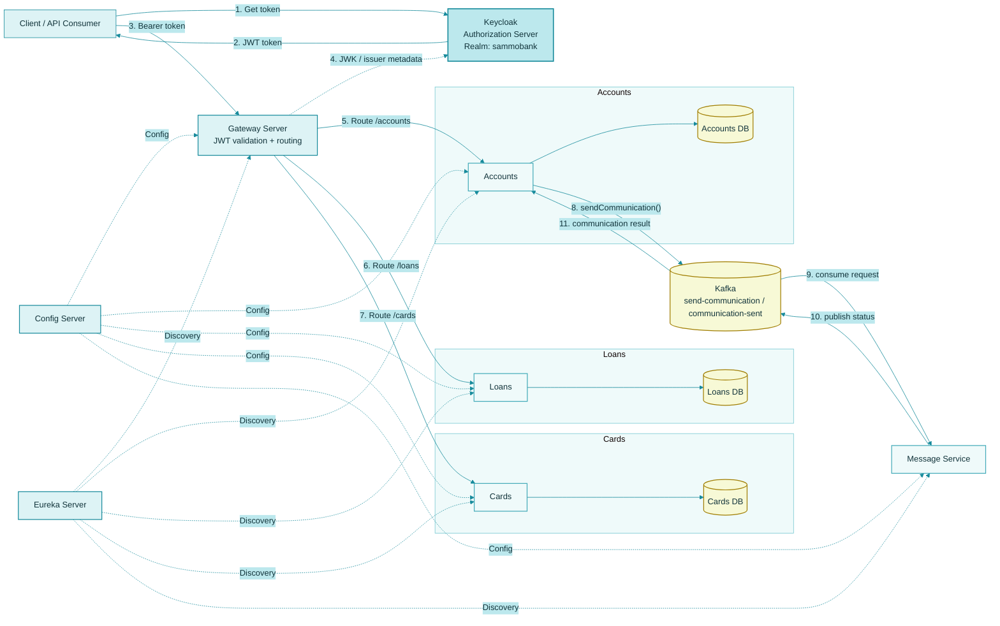

# SammoBank Microservices

### SammoBank is a banking microservices application built with Spring Boot and Spring Cloud. It demonstrates centralized configuration, service discovery, gateway-based API routing, OAuth2 security with Keycloak, asynchronous messaging with Kafka, observability, containerization, and deployment automation.

The project includes:
- Accounts, Loans, and Cards business services
- Gateway Server for routing and JWT validation
- Eureka Server for service discovery
- Config Server for centralized configuration
- Keycloak for identity and access management
- Kafka-based asynchronous messaging
- Docker Compose and Helm-based deployment resources
- Observability with Prometheus, Loki, Tempo, and Grafana Docker Compose and Helm configurations are provided for multiple environments. The Docker Compose default configuration and Helm dev-env configuration represent the local development setup and have been validated. The QA and production configurations are also included but may require further updates and validation.

## Architecture

SammoBank follows a layered microservices architecture with shared platform services and domain business services.

### High-Level Architecture


### Current Implementation Notes

This project currently follows these implementation patterns:
- Keycloak is used as the OAuth2 Authorization Server
- Gateway Server acts as the JWT resource server
- JWT roles are mapped from `realm_access.roles`
- Gateway enforces route-level authorization:
     - `/sammobank/accounts/**` => `ROLE_ACCOUNTS`
     - `/sammobank/cards/**` => `ROLE_CARDS`
     - `/sammobank/loans/**` => `ROLE_LOANS`

- Kafka is the active asynchronous messaging implementation
- Spring Cloud Stream is used for Kafka bindings and message processing
- RabbitMQ remains as a historical comparison/reference and is not the active messaging layer in the codebase

### Core Components
| Component | Responsibility |
|---|---|
| **Spring Cloud Gateway** | Provides a single entry point for API requests and routes them to the appropriate service. |
| **Keycloak** | Manages identities and access tokens using OAuth 2.0 and OpenID Connect. |
| **Eureka Server** | Enables service registration and discovery. |
| **Config Server** | Centralizes external configuration for application services. |
| **Accounts Service** | Handles account-related business operations. |
| **Loans Service** | Handles loan-related business operations. |
| **Cards Service** | Handles card-related business operations. |
| **Apache Kafka** | Supports asynchronous communication through messages and events. |
| **Databases** | Persist business data for the respective services. |
| **Observability Stack** | Collects and visualizes application telemetry, logs, metrics, and traces. |

### Service Endpoints
| Service | Default Port |
|---|---:|
| Config Server | `8071` |
| Eureka Server | `8070` |
| Gateway Server | `9090` |
| Accounts Service | `8080` |
| Loans Service | `8090` |
| Cards Service | `9000` |

These are the application ports used by the documented architecture. External port mappings may differ between Docker Compose and Kubernetes deployments.

### Request and Communication Flow
1. The client authenticates with Keycloak and obtains an access token.
2. The client sends API requests to Spring Cloud Gateway with the token.
3. The Gateway validates the JWT and checks the required role/authority.
4. The Gateway routes the request to the correct business service.
5. Eureka provides service discovery, while Config Server supplies external configuration.
6. Services communicate synchronously where required and use Kafka for asynchronous messaging where configured.
7. Each business service accesses its associated database.
8. Observability components collect and visualize telemetry from the application and its infrastructure.

### Inter-Service Communication

SammoBank uses 
- OpenFeign for declarative HTTP communication between services
- Eureka for service registration and discovery
- Spring Cloud LoadBalancer for client-side service selection
- Kafka for asynchronous messaging

For example, the Accounts service can call the Loans and Cards services to retrieve related information and aggregate a customer-details response.

This allows business services to remain loosely coupled while still integrating through controlled APIs and event streams.
## Microservices

SammoBank consists of three business microservices and four supporting infrastructure services. Each service is maintained as an independent Maven project with its own `pom.xml` and Maven Wrapper.

### Business Services
| Service | Description |
|---|---|
| **Accounts** | Manages account-related business operations. |
| **Loans** | Manages loan-related business operations. |
| **Cards** | Manages card-related business operations. |

### Infrastructure Services
| Service | Description |
|---|---|
| **Gateway Server** | Routes incoming API requests to the appropriate microservice. |
| **Eureka Server** | Provides service registration and discovery. |
| **Config Server** | Provides centralized external configuration to the microservices. |
| **Message** | Handles messaging-related functionality within the application. |

## Project Structure

```text
MICROSERVICES/
├── .github/
│   └── workflows/
│       └── ci-cd.yml
├── accounts/
├── cards/
├── configserver/
├── docker/
│   └── java25-curl/
│       └── DockerFIle
├── docker-compose/
│   ├── default/                  # Complete local setup
│   │   ├── common-config.yml
│   │   └── docker-compose.yml
│   ├── keycloak/
│   │   └── realm/
│   │       └── sammobank-realm.json
│   ├── observability/
│   │   ├── alloy/
│   │   ├── grafana/
│   │   ├── loki/
│   │   ├── mysql/
│   │   ├── prometheus/
│   │   └── tempo/
│   ├── prod/
│   │   ├── common-config.yml
│   │   └── docker-compose.yml
│   └── qa/
│       ├── common-config.yml
│       └── docker-compose.yml
├── eurekaserver/
├── gatewayserver/
├── helm/
│   ├── environments/
│   │   ├── dev-env/              # Complete local setup
│   │   ├── qa-env/
│   │   └── prod-env/
│   ├── grafana/
│   ├── grafana-alloy/
│   ├── grafana-loki/
│   ├── grafana-tempo/
│   ├── kafka/
│   ├── keycloak/
│   ├── kube-prometheus/
│   ├── mysql-exporter/
│   ├── sammobank-common/
│   ├── sammobank-databases/
│   └── sammobank-services/
├── k8/                           # Basic Kubernetes setup
│   ├── 1_keycloak.yml
│   ├── 2_configmap.yml
│   ├── 3.1_configserver.yml
│   ├── 3.2_configserver-secret.yml  # Not committed
│   ├── 4_eurekaserver.yml
│   ├── 5_databases.yml
│   ├── 6_accounts.yml
│   ├── 7_cards.yml
│   ├── 8_loans.yml
│   └── 9_gateway.yml
├── loans/
├── message/
├── docker-compose.yml             # Required for local setup
├── Readme.md
└── .gitignore
```
Each service is maintained as an independent Maven project. The repository also includes containerization, deployment, API testing, and CI/CD resources.

## Technology Stack

### Backend Development
- **Java 25**
- **Spring Boot**
- **Spring Cloud**
- **Spring Data JPA / Hibernate**
- **Spring Boot Actuator**
- **Spring Validation**
- **Springdoc OpenAPI**

### Microservices Infrastructure
- **Spring Cloud Gateway** — API routing
- **Spring Cloud Netflix Eureka** — Service discovery
- **Spring Cloud Config Server** — Centralized configuration
- **OpenFeign** — Declarative inter-service HTTP communication

### Security
- **Keycloak** — Identity and access management
- **OAuth 2.0 / OpenID Connect** — Authentication and authorization protocols
- **JWT** — Token-based security

### Messaging
- **Apache Kafka** — Asynchronous messaging between application components

### Databases
- **MySQL** — Relational data persistence

### Observability
- **Prometheus** — Metrics collection
- **Grafana** — Metrics and telemetry visualization
- **Grafana Loki** — Log aggregation
- **Grafana Alloy** — Telemetry collection and forwarding
- **Grafana Tempo** — Distributed tracing
- **MySQL Exporter** — MySQL metrics collection
- **OpenTelemetry** — Instrumentation and telemetry standards

### Containerization and Deployment
- **Docker** — Containerization
- **Docker Compose** — Local multi-container environment
- **Kubernetes** — Container orchestration
- **Helm** — Kubernetes application packaging and deployment
- **Jib** — Building and publishing Java container images

### CI/CD and Build Tools
- **GitHub Actions** — Automated build, test, and container image publishing
- **Maven** — Dependency management and build automation
- **Maven Wrapper** — Consistent Maven execution across environments
- **Git** — Version control
- **Docker Hub** — Container image registry

## Prerequisites

Ensure the following tools are installed before setting up SammoBank locally.
- **Java 25** — Required for building and running the application.
- **Git** — For cloning the repository.
- **Docker Engine / Docker Desktop** — For running the supporting infrastructure and application containers.
- **Docker Compose** — For starting the local multi-container environment.
- **Kubernetes cluster** — Required when deploying through Helm.
- **Helm 3** — For managing Kubernetes deployments.
- **GitHub account** — Required to access the repository and CI/CD workflow.
- **Docker Hub account** — Required if building and publishing container images to your own registry.

### External Configuration

The Config Server retrieves application configuration from an external Git repository. Ensure that the repository is accessible and that any required credentials are configured before starting the application.

- **Configuration repository:** [MICROSERVICES-CONFIG](https://github.com/SoyaChunkz/MICROSERVICES-CONFIG)
- **Setup guide:** [Local Setup](docs/project-setup.md)

## Getting Started
Follow these steps to start SammoBank using the default Docker Compose configuration.

### 1. Clone the Repository
```powershell
git clone https://github.com/SoyaChunkz/MICROSERVICES.git
cd MICROSERVICES
```

### 2. Start the Application
Navigate to the default Docker Compose directory and start the services:
```powershell
cd docker-compose/default
docker compose up -d
```
Docker Compose starts the application services and their configured infrastructure dependencies in the background.

### 3. Verify the Running Containers
Check the status of the containers:
```powershell
docker compose ps
```
To inspect the logs for all services:
```powershell
docker compose logs -f
```
To view logs for a specific service:
```powershell
docker compose logs -f accounts
```
Replace `accounts` with the relevant Compose service name.

### 4. Stop the Application
To stop and remove the containers created by the Compose configuration:
```powershell
docker compose down
```
Named volumes are retained by default, so persistent data is not removed by this command.

> **Note:** Ensure the required external configuration repository and credentials are available before starting the application. The default configuration is the validated local setup.

## Build and Container Images

Each SammoBank microservice is an independent Maven project with its own Maven Wrapper. Application builds, local container images, Helm deployments, and CI/CD publishing are separate workflows.

### Build and Test a Microservice
From the repository root, navigate to the service directory and run the Maven Wrapper.

For example, to build and test the Accounts service:
```powershell
cd accounts 
.\mvnw.cmd clean verify
```
The `clean verify` command cleans previous build output, compiles the application, runs tests, and executes the Maven verification phase.

The same process can be used for the other services:
- `accounts`
- `cards`
- `loans`
- `gatewayserver`
- `eurekaserver`
- `configserver`
- `message`

### Custom Java Base Image
SammoBank uses a custom Java 25 runtime base image that includes `curl`, which is required by the container health checks.

The Dockerfile is maintained at:

```text
docker/
└── java25-curl/
    └── DockerFIle
```

Build the base image locally from the repository root:
```powershell
docker build -t soyachunkz/java25-curl:latest -f docker/java25-curl/DockerFIle .
```

This creates the `soyachunkz/java25-curl:latest` image locally, which can be used as the base image when building application containers.

The custom base image provides a consistent runtime environment for the application containers.

### Build Application Images Locally
To build an application image for local Docker Compose or Kubernetes use, first build and test the relevant service.

For example, from the repository root:

```powershell
cd accounts
.\mvnw.cmd -DskipTests compile jib:dockerBuild -Dimage=soyachunkz/accounts:latest
```

This uses Jib to build the Accounts container image directly into the local Docker daemon. The image can then be used by Docker Compose or by a local Kubernetes cluster that can access the image.

Repeat the process for the other services by changing the directory and image name.

For example:
```powershell
cd ..\cards
.\mvnw.cmd -DskipTests compile jib:dockerBuild -Dimage=soyachunkz/cards:latest
```

The `compile` phase ensures that application classes are available before Jib builds the image. The `-DskipTests` option skips test execution, so run `clean verify` first when you need to validate the service.

### Docker Compose

Docker Compose runs the application and its supporting infrastructure using the image references defined in the Compose configuration. It does not automatically build application images unless build instructions are configured in the Compose file.

The local workflow is:
1. Build the custom Java base image if needed.
2. Build the required application images locally.
3. Ensure the image names and tags match those referenced in the Compose configuration.
4. Start the environment.

From the repository root, run:
```powershell
cd docker-compose/default
docker compose up -d
```

The `docker-compose/default` configuration is the validated local setup.

### Kubernetes with Helm

Helm manages Kubernetes resources using charts and environment-specific values. It does not build application images, so the required images must be built separately and made accessible to the Kubernetes cluster.

The local workflow is:
1. Build the custom Java base image if needed.
2. Build the required application images.
3. Make the images accessible to the Kubernetes cluster, either by loading them into the local cluster or publishing them to an accessible container registry.
4. Ensure the Helm values reference the correct image names and tags.
5. Install or upgrade the application using Helm.

The validated local Kubernetes configuration is located at:
```text
helm/environments/dev-env/
```

See the deployment documentation for the complete image preparation and Helm installation workflow.

### CI/CD Image Publishing
SammoBank uses [Jib](https://github.com/GoogleContainerTools/jib) in GitHub Actions to build and publish application images to Docker Hub without requiring a local Docker daemon for the image build.

The workflow runs build and test jobs for relevant services and publishes images when the required conditions are met.

Published application images use the following naming convention:
```text
soyachunkz/<service>:<git-commit-sha>
```

For example:
```text
soyachunkz/accounts:<git-commit-sha>
```

The Git commit SHA identifies the source revision associated with the published image.

### Local Builds vs. CI/CD
| Workflow | Image destination | Purpose |
|---|---|---|
| Maven `clean verify` | No container image is created by this command alone | Compile, test, and verify a service |
| Jib `jib:dockerBuild` | Local Docker daemon | Build an image for local testing |
| Docker Compose | Uses the image references in the Compose configuration | Run the local multi-container environment |
| Helm | Uses images accessible to the Kubernetes cluster | Deploy the application to Kubernetes |
| GitHub Actions with Jib | Docker Hub | Publish versioned images after the required CI/CD checks |

Local builds are intended for development and testing. CI/CD publishing is the automated path for producing and publishing revision-specific images.

## CI/CD

SammoBank uses GitHub Actions to automate service builds, testing, and container image publishing.

### Workflow Triggers
The CI/CD workflow runs on:
- Pull requests targeting `main`.
- Pushes to `main`.
- Manual workflow dispatch.

### Pipeline Stages
1. **Change Detection** — Identifies which microservices have changed since the last successful publishing checkpoint.
2. **Build and Test** — Builds and verifies the relevant Maven projects.
3. **Image Publishing** — Uses Jib to build and publish application images to Docker Hub when the required conditions are met.
4. **Publishing Checkpoint** — Updates the `ci/last-published` Git tag after the required builds and image publishing jobs succeed.

### Container Image Tags

Published images are tagged with the Git commit SHA so each image can be associated with a specific source revision.
```text
soyachunkz/<service>:<git-commit-sha>
```

### Publishing Checkpoint
The `ci/last-published` tag tracks the last commit for which the required image publishing workflow completed successfully. Change detection uses this checkpoint to identify changes that still need to be processed.

The checkpoint advances only after the required pipeline stages succeed, helping prevent failed publishing runs from being treated as completed.

More details on CI-CD is available at [CI-CD](docs/ci-cd.md).


## Security

SammoBank uses Keycloak and Spring Security to implement token-based protection across the platform.

### Keycloak and OAuth 2.0
Keycloak acts as the identity and access management provider. It supports authentication and token issuance using OAuth 2.0 and OpenID Connect (OIDC).

### JWT-Based Security
JSON Web Tokens (JWTs) are used to carry claims about an authenticated identity. The API gateway validates access tokens before routing protected requests to the appropriate services.

The Gateway validates JWTs and enforces access rules using authorities derived from Keycloak roles. The actual realm in the imported configuration is sammobank, and the current Keycloak clients include:
- sammobank-callcenter-ac
- sammobank-callcenter-cc

More detailed security flow documentation is available at [Keycloak Security](docs/keycloak-security.md).


## Messaging

SammoBank uses Kafka for asynchronous messaging in the current implementation. The messaging service consumes communication requests, processes email/SMS actions, and publishes result events back to Accounts.

RabbitMQ is included in earlier project documentation as a historical comparison and design reference, but the active code path uses Kafka and Spring Cloud Stream.

More detailed messaging flow documentation is available at [Messaging](docs/messaging.md).

## Observability

SammoBank includes an observability stack for monitoring application health, collecting metrics, aggregating logs, and tracing requests across services.

### Observability Stack
| Component | Responsibility |
|---|---|
| **Prometheus** | Collects and stores metrics for monitoring. |
| **Grafana** | Provides dashboards for visualizing metrics, logs, and traces. |
| **Grafana Loki** | Aggregates and stores application logs. |
| **Grafana Alloy** | Collects and forwards telemetry data. |
| **Grafana Tempo** | Stores and provides access to distributed traces. |
| **MySQL Exporter** | Exposes MySQL metrics for Prometheus collection. |
| **OpenTelemetry** | Provides instrumentation and telemetry export for distributed tracing. |
| **Spring Boot Actuator** | Exposes application health and monitoring endpoints. |

### Monitoring Capabilities
The observability stack supports:
- Application health and readiness checks.
- Metrics collection and visualization.
- Centralized log aggregation.
- Distributed tracing across instrumented services.
- MySQL performance and health monitoring.

---

<!-- adding this comment to check CODEOWNERS approval when a PR is raised -->