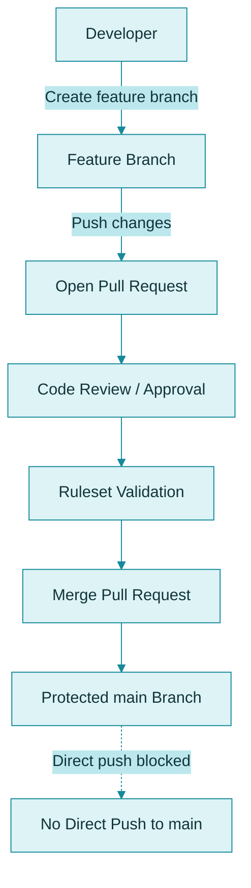

# CI/CD in SammoBank

SammoBank uses GitHub Actions as the primary CI/CD workflow for building, testing, and publishing microservice container images. The repository also includes branch protection and CODEOWNERS configuration to enforce review-based changes before merging into `main`.

## Table of Contents

- [Overview](#overview)
- [CI/CD Workflow Goals](#cicd-workflow-goals)
- [Current Workflow Pattern](#current-workflow-pattern)
- [Build and Test Pipeline](#build-and-test-pipeline)
- [Image Publishing with Jib](#image-publishing-with-jib)
- [Container Image Tagging](#container-image-tagging)
- [Publishing Checkpoint Strategy](#publishing-checkpoint-strategy)
- [GitHub Main Branch Protection & CODEOWNERS Setup](#github-main-branch-protection--codeowners-setup)
- [Troubleshooting and Operational Notes](#troubleshooting-and-operational-notes)

## 1. Overview

The project uses a multi-service CI/CD model:

- Each service is an independent Maven project.
- Build verification is performed using Maven.
- Container images are built using Jib.
- Images are published to Docker Hub.
- The workflow detects which services have changed and processes only the relevant ones.

This approach is aligned with the project's structure:

```text
MICROSERVICES/
├── accounts/
├── cards/
├── loans/
├── configserver/
├── eurekaserver/
├── gatewayserver/
└── message/
```

## 2. CI/CD Workflow Goals

The CI/CD process is intended to:

- Validate each changed microservice.
- Prevent broken code from being published.
- Build container images using Jib.
- Attach a version or revision tag to each published image.
- Maintain a workflow checkpoint to track the last successfully published revision.

## 3. Current Workflow Pattern

The following diagram illustrates the CI/CD workflow:

```mermaid
%%{init: {
  'theme': 'base',
  'themeVariables': {
    'primaryColor': '#DDF3F5',
    'primaryTextColor': '#12343B',
    'primaryBorderColor': '#168A9B',
    'lineColor': '#168A9B',
    'secondaryColor': '#BCE8ED',
    'tertiaryColor': '#EFFAFA',
    'clusterBkg': '#EFFAFA',
    'clusterBorder': '#78C9D2',
    'fontFamily': 'Arial, sans-serif'
  }
}}%%
flowchart LR
    Dev["Developer"] -->|"Push / PR"| GitHub["GitHub"]
    GitHub --> Change["Change Detection"]
    Change --> Build["Build + Test"]
    Build --> Publish["Jib Image Build"]
    Publish --> Registry["Docker Hub"]
    Registry --> Checkpoint["Publishing Checkpoint"]
    Checkpoint --> Main["main branch"]
```



The actual CI/CD behavior depends on the workflow file and GitHub settings. This diagram represents the project's documented workflow pattern.

## 4. Build and Test Pipeline

The CI/CD workflow generally follows this sequence:

1. Detect which microservices have changed.
2. Build only the relevant Maven projects.
3. Run Maven verification, including compilation and tests.
4. Fail the workflow if required validation fails.
5. Publish container images only after successful validation.

### Local Build and Verification

Example for the Accounts service:

```powershell
cd accounts
.\mvnw.cmd clean verify
```

The same approach applies to the following services:

- `accounts`
- `cards`
- `loans`
- `gatewayserver`
- `eurekaserver`
- `configserver`
- `message`

The repository may also define service-specific jobs for image publishing and artifact generation.

## 5. Image Publishing with Jib

SammoBank uses **Jib** to build container images directly from Java projects without requiring a Dockerfile-based build at every workflow stage.

### Local Image Build

Example for the Accounts service:

```powershell
cd accounts
.\mvnw.cmd -DskipTests compile jib:dockerBuild -Dimage=soyachunkz/accounts:latest
```

In CI/CD, the same approach is used to publish images to a remote container registry.

### Why Jib?

- Keeps the Java build and container build closely integrated.
- Avoids requiring a Docker-in-Docker build pipeline.
- Integrates well with GitHub Actions.
- Simplifies container image generation and publishing.

## 6. Container Image Tagging

Published images are intended to be tagged using a Git revision identifier.

### Image Naming Pattern

```text
soyachunkz/<service>:<git-commit-sha>
```

Example:

```text
soyachunkz/accounts/<git-commit-sha>
```

The intended Docker image reference is:

```text
soyachunkz/accounts:<git-commit-sha>
```

This associates each published image with a specific source revision and makes it easier to trace deployed images back to their corresponding Git commit.

## 7. Publishing Checkpoint Strategy

The repository uses a Git tag as a publishing checkpoint:

```text
ci/last-published
```

This tag tracks the last successfully published revision.

### How It Works

- Identify the last successfully published revision.
- Determine which changes have not yet been built and published.
- Process the required services based on the changes.
- Update the checkpoint only after successful publishing.

The goal is to ensure that only successfully validated and published revisions are treated as the latest successful delivery point.

This also helps the workflow avoid unnecessarily rebuilding services when no relevant changes have occurred.

## 8. GitHub Main Branch Protection & CODEOWNERS Setup

We configured branch protection for the SammoBank repository (`MICROSERVICES`) to prevent direct pushes to `main` and ensure changes go through Pull Requests and reviews.

### 8.1. GitHub Ruleset for `main`

An active branch ruleset was created targeting the `main` branch.

The configured rules are:

| Rule | Status | Purpose |
|---|---|---|
| Restrict deletions | Enabled | Prevents accidental deletion of `main`. |
| Require a pull request before merging | Enabled | Prevents direct pushes to `main`. |
| Required approvals | 1 | Requires at least one approval before merging. |
| Block force pushes | Enabled | Prevents force-pushing to `main`. |

The following additional settings were discussed as recommendations:

- Dismiss stale approvals when new commits are pushed.
- Require approval of the most recent reviewable push.

These were recommendations and were not necessarily enabled in the final ruleset at the time of setup.

### 8.2. CODEOWNERS Configuration

We created the following file:

```text
.github/
└── CODEOWNERS
```

Its contents:

```text
# Require the repository owner to review all changes
* @SoyaChunkz
```

**How it works:**

- `*` matches every file in the repository.
- `@SoyaChunkz` identifies the repository owner as the Code Owner.
- Changes to any file require the designated Code Owner's review when the ruleset requires Code Owner approval.

The CODEOWNERS file was committed and pushed to the repository.

### 8.3. Pull Request Workflow

The configured workflow is:



This ensures that:

- Developers do not push directly to `main`.
- Every change goes through a Pull Request.
- Required review rules are enforced.
- The repository owner is designated as the Code Owner for all files.

### 8.4. Working with a Single Code Owner

Since the CODEOWNERS file currently contains:

```text
* @SoyaChunkz
```

There are two main scenarios:

| Scenario | Result |
|---|---|
| Another developer creates a PR | The repository owner must review and approve it. |
| The repository owner creates a PR | The repository owner cannot approve their own PR. |

Since the ruleset requires one approval, a Pull Request created by the repository owner needs another eligible reviewer.

**Available options:**

1. Add another trusted reviewer to CODEOWNERS:

   ```text
   * @SoyaChunkz @COLLABORATOR_USERNAME
   ```

2. Keep Pull Request enforcement but set required approvals to `0` when working solo.

3. Add another eligible repository reviewer who can approve the repository owner's Pull Requests.

If the project is maintained by a single person, option 2 is a practical choice while retaining mandatory Pull Requests.

### 8.5. Final Repository Setup

The configured repository protection consists of:

- An active branch ruleset protecting `main`.
- Direct pushes to `main` blocked.
- Force pushes blocked.
- Deletion of `main` restricted.
- Pull Requests required before merging.
- One required approval configured.
- `.github/CODEOWNERS` assigning repository-wide ownership to `@SoyaChunkz`.

This provides a controlled, review-based merge workflow for the repository.

## 9. Troubleshooting and Operational Notes

### GitHub Actions Build Failures

- Check the GitHub Actions workflow logs.
- Identify which service build or test failed.
- Verify the Maven project configuration.
- Confirm the correct service path is included in change-detection logic.

### Image Publishing Failures

- Verify Jib publishing configuration.
- Confirm Docker Hub credentials are valid.
- Check that the GitHub Actions secrets are configured correctly.
- Review the workflow logs for authentication or registry errors.

The workflow uses the following GitHub repository secrets:

```text
DOCKERHUB_USERNAME
DOCKERHUB_TOKEN
```

### Publishing Checkpoint Issues

- Review the `ci/last-published` checkpoint logic.
- Confirm that the checkpoint is updated only after successful publishing.
- Check whether the workflow correctly detects changes since the previous published revision.

### Branch Protection and CODEOWNERS Issues

- Confirm that the branch ruleset is active and targets `main`.
- Verify that Pull Requests are required before merging.
- Check the required approval count.
- Ensure CODEOWNERS is present under `.github/CODEOWNERS`.
- Confirm that Code Owner approval is required in the ruleset if repository-wide ownership enforcement is intended.
- Make sure the configured reviewers are eligible to approve Pull Requests.

---

