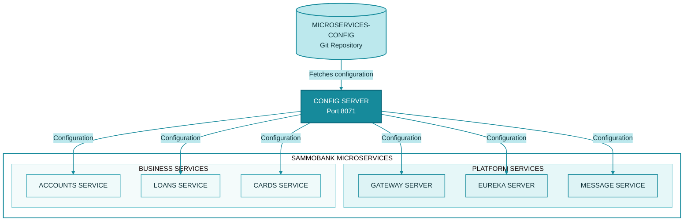
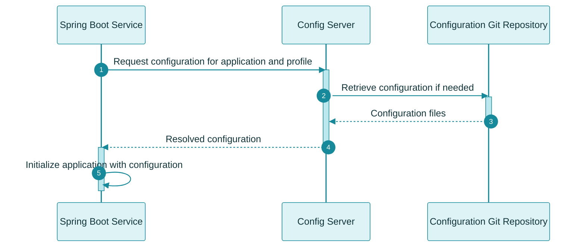

# Configuration Management with Spring Cloud Config

SammoBank uses **Spring Cloud Config Server** to centralize configuration for its microservices. Instead of maintaining all environment-specific settings independently inside each service, configuration can be stored in a Git repository and retrieved by applications through the Config Server.

## Table of Contents

- [Why Centralized Configuration?](#why-centralized-configuration)
- [Spring Cloud Config Architecture](#spring-cloud-config-architecture)
- [SammoBank Implementation](#sammobank-implementation)
- [Configuration Loading Flow](#configuration-loading-flow)
- [Application Names and Profiles](#application-names-and-profiles)
- [Local Development Setup](#local-development-setup)
- [Configuration and Secrets](#configuration-and-secrets)
- [Configuration Changes and Refresh](#configuration-changes-and-refresh)
- [Troubleshooting](#troubleshooting)

## Why Centralized Configuration?

In a microservices architecture, each service may require configuration for:

- Database connections
- Service discovery
- Gateway routing
- Kafka connectivity
- Security and OAuth2 settings
- Logging and monitoring
- Environment-specific properties

Maintaining separate copies of configuration across multiple services and environments can lead to duplication, inconsistent settings, and more difficult maintenance.

Spring Cloud Config provides a centralized way to store and distribute application configuration.

### Benefits

- **Centralization:** Store configuration outside individual application codebases.
- **Consistency:** Share common configuration across services where appropriate.
- **Environment separation:** Maintain different settings for local development, QA, and production.
- **Version control:** Use Git history to track configuration changes.
- **Maintainability:** Update configuration in a central location rather than duplicating it across service projects.

Centralized configuration does not automatically make every configuration change take effect in a running application. The behavior depends on the application's refresh mechanism and whether the relevant properties can be refreshed safely.

## Spring Cloud Config Architecture

Spring Cloud Config has two main roles:

- **Config Server:** Retrieves configuration from a configured backend, such as a Git repository, and exposes it to client applications.
- **Config Client:** An application that retrieves its configuration from the Config Server.

In SammoBank, the Config Server uses an external Git repository as its configuration source.

The diagram represents the intended configuration architecture. The exact set of Config Clients depends on each application's current configuration.

## SammoBank Implementation

### Configuration Repository

SammoBank's external configuration repository is:

**[MICROSERVICES-CONFIG](https://github.com/SoyaChunkz/MICROSERVICES-CONFIG)**

The repository is separate from the main application repository:

- **Application repository:** Contains Spring Boot services, infrastructure definitions, deployment resources, and CI/CD workflows.
- **Configuration repository:** Contains application configuration consumed by the Config Server.

Keeping configuration separate allows the same application code to use different settings across environments.

The repository's actual directory layout, filenames, and profile naming should be checked against its current contents before changing application configuration.

### Config Server

The Config Server is maintained in the `configserver/` project.

Its responsibilities include:

1. Connecting to the configured Git repository.
2. Retrieving configuration files.
3. Resolving configuration for a requested application and profile.
4. Exposing the resulting configuration through the Spring Cloud Config API.

The documented default port is `8071`.

The Config Server must be able to access its configured Git repository. If the repository is private, the required credentials must be configured securely.

### Config Clients

The Spring Boot services that use Spring Cloud Config retrieve their configuration from the Config Server.

Examples include the Accounts, Loans, Cards, and Gateway projects, subject to their current configuration.

A service must have the appropriate Config Client dependency and bootstrap configuration for the selected Spring Boot and Spring Cloud versions.

## Configuration Loading Flow

A typical startup flow looks like this:

The precise loading behavior depends on the Spring Cloud Config version and client configuration. For example, some setups use Config Data imports, while older configurations may use a bootstrap context.

### Why Startup Order Matters

When a service requires configuration from the Config Server, the Config Server must be reachable during the relevant configuration-loading phase.

A typical local startup order is:

1. Start the infrastructure dependencies required by the application.
2. Start Config Server.
3. Start Eureka Server.
4. Start the remaining microservices and Gateway according to their configured dependencies.

A service may fail to start or may not load the intended configuration if the Config Server is unavailable or the requested configuration cannot be resolved.

## Application Names and Profiles

Spring Cloud Config resolves configuration based on an application's name, profile, and optionally a label identifying a branch, tag, or commit.

Conceptually, a client requests configuration using values such as:

- **Application name:** Identifies the application.
- **Profile:** Selects environment-specific configuration.
- **Label:** Identifies a configuration repository version, when configured.

For example, an application might request its `default` or `qa` profile.

The actual names and available profiles depend on the configuration repository and each application's settings. Do not assume that every service supports every profile.

### Environment-Specific Configuration

SammoBank includes local, QA, and production deployment configurations.

Environment-specific settings may include:

- Database endpoints
- Kafka bootstrap servers
- Service URLs
- Security issuer settings
- Logging levels
- Monitoring endpoints

Values must match the environment in which the application runs. In particular, a hostname that works inside Docker Compose may not resolve from an application running directly in IntelliJ.

## Local Development Setup

### 1. Check the Configuration Repository

Open the configuration repository:

[https://github.com/SoyaChunkz/MICROSERVICES-CONFIG](https://github.com/SoyaChunkz/MICROSERVICES-CONFIG)

Confirm that the required application configuration exists and that you have access to it.

### 2. Configure the Config Server

Check the Config Server's active configuration to confirm:

- The Git repository URI is correct.
- The expected branch or label exists.
- Required authentication credentials are configured.
- The Config Server listens on the expected port.
- Any required environment variables are available.

Do not place repository passwords or access tokens directly in committed configuration files.

### 3. Start Config Server

Run the `configserver` Spring Boot application from IntelliJ IDEA or use the appropriate containerized setup.

Wait for startup to complete and check the logs for Git authentication, repository access, or configuration-loading errors.

### 4. Start Config Clients

Start the remaining services after confirming that the Config Server is healthy.

Inspect each service's logs to verify that it loads the expected configuration and profile.

For the complete local startup procedure, see [Project Setup](project-setup.md).

## Configuration and Secrets

Configuration and secrets should be managed carefully.

### Configuration Values

Examples of ordinary configuration include:

- Application names
- Non-sensitive service settings
- Logging levels
- Feature flags
- Non-secret environment-specific values

These values can be version-controlled when appropriate.

### Sensitive Values

Examples of secrets include:

- Database passwords
- OAuth2 client secrets
- Git access tokens
- API keys
- Signing credentials

Follow these practices:

- Do not commit real secrets to either repository.
- Use environment variables, a secret manager, or an appropriate deployment-specific secret mechanism.
- Restrict access to private configuration repositories.
- Use separate credentials for different environments.
- Rotate credentials when required.
- Avoid printing secrets in application logs or CI/CD output.

A private Git repository is an access-control mechanism, not a replacement for proper secret management.

## Configuration Changes and Refresh

Updating a configuration file in Git does not necessarily update every running application immediately.

The result depends on how the Config Server and clients are configured.

Possible approaches include:

- Restarting the affected service so it retrieves configuration during startup.
- Using Spring Cloud refresh mechanisms when the application has been configured to support them.
- Triggering a refresh through a secured operational mechanism, if one is implemented.

Before documenting or relying on live refresh, verify that the relevant refresh dependencies, endpoints, and triggers are present in the current project.

SammoBank previously used Spring Cloud Bus with RabbitMQ for refresh-related behavior, but RabbitMQ has been removed from the current messaging setup. Do not assume that Spring Cloud Bus refresh is currently available.

## Troubleshooting

### Config Server Cannot Access Git

Check:

- The repository URI.
- Network connectivity.
- Repository visibility and access permissions.
- Credentials, if required.
- The configured branch or label.

### A Client Cannot Reach Config Server

Check that:

- Config Server is running.
- The configured Config Server address is correct for the client's runtime environment.
- The expected port is reachable.
- Docker networking and hostnames are configured correctly.

Remember that `localhost` inside a container refers to that container itself.

### Configuration Is Missing

Check the requested application name, profile, label, and the corresponding files in the configuration repository.

Verify that the client is requesting the intended profile and that the Config Server resolves the expected configuration.

### The Application Uses Old Configuration

Check whether the service has restarted since the configuration changed.

If the project is expected to refresh configuration without restarting, verify that the required refresh mechanism is actually configured and enabled.

### Database or Kafka Connection Fails

Check the resolved configuration for the relevant endpoint, port, credentials, and environment-specific hostname.

Ensure that the service is using the correct connection details for IntelliJ, Docker Compose, or Kubernetes.

---