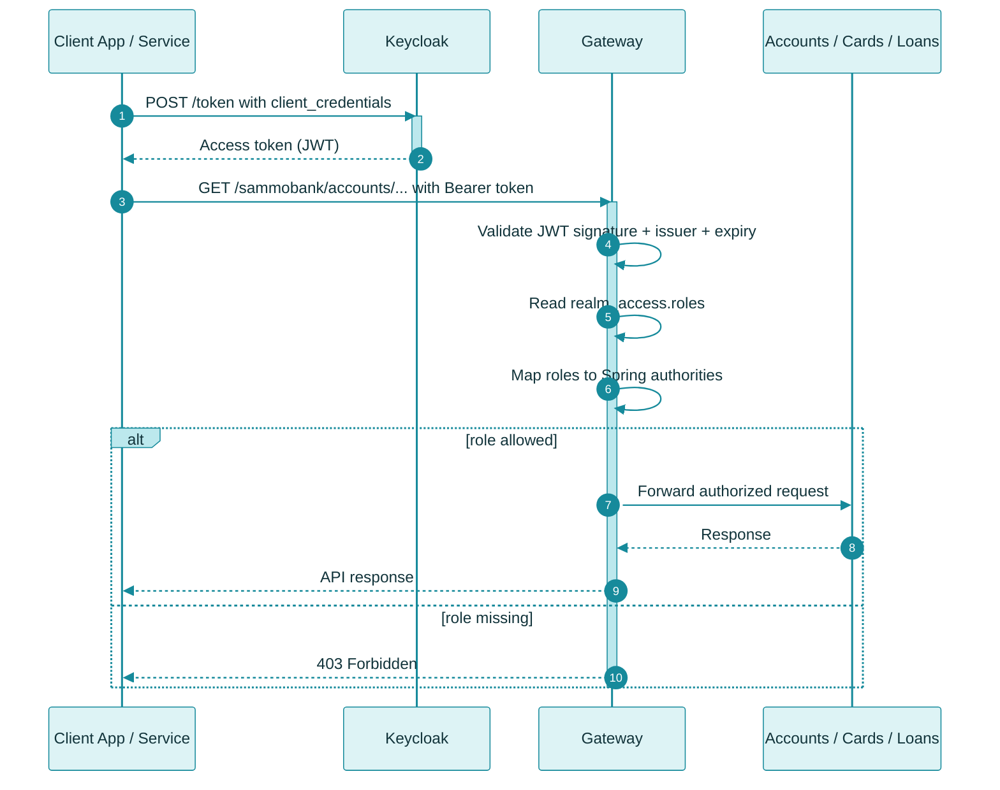
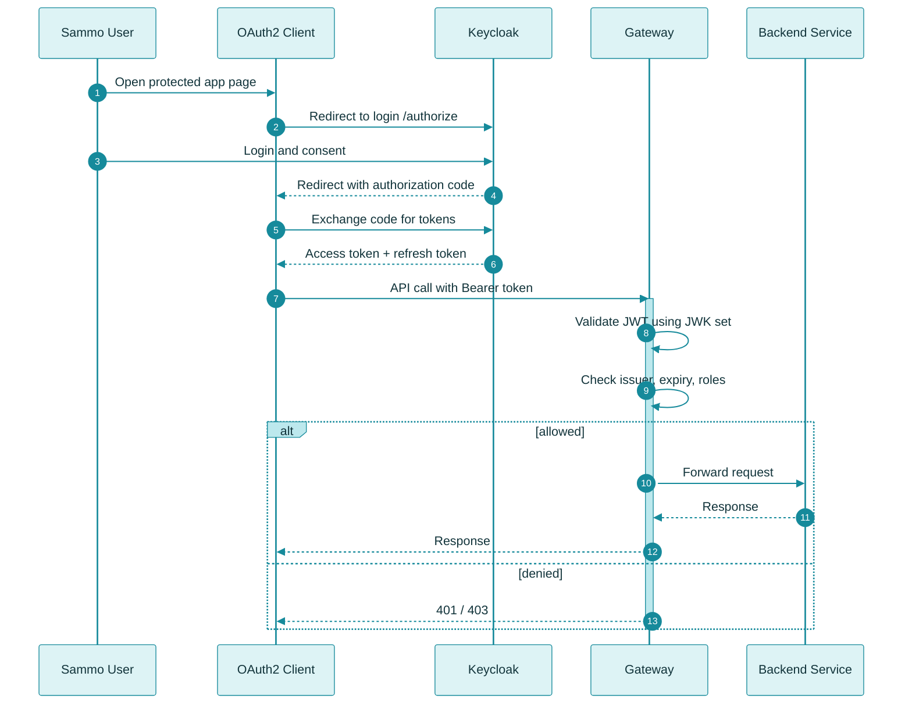
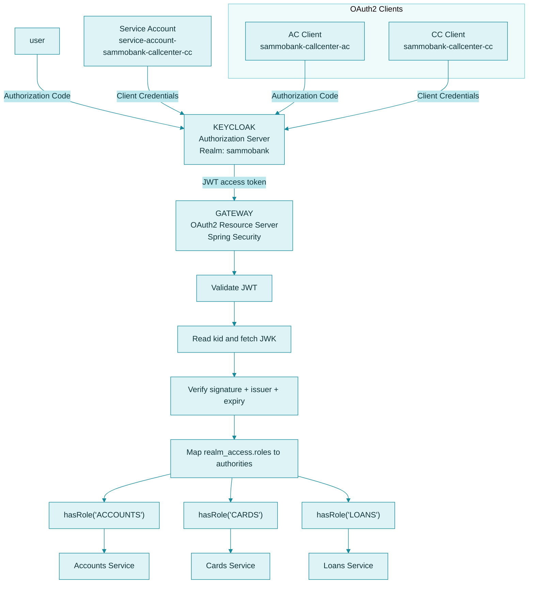

# OAuth2 Security with Keycloak

SammoBank implements OAuth 2.0-based authentication and authorization using Keycloak as the Authorization Server and the Spring Cloud Gateway as the OAuth2 Resource Server.

Keycloak issues signed JWT access tokens, and the Gateway validates those tokens before allowing requests to reach the Accounts, Cards, or Loans services.
## Table of Contents

- [Overview](#overview)
- [Key Concepts](#key-concepts)
- [OAuth2 Grant Types](#oauth2-grant-types)
- [Architecture](#architecture)
- [Authentication and Authorization Flow](#authentication-and-authorization-flow)
- [JWT Validation](#jwt-validation)
- [Local Keycloak Setup](#local-keycloak-setup)
- [Testing the Authentication Flow](#testing-the-authentication-flow)
- [Security Best Practices](#security-best-practices)
- [Troubleshooting](#troubleshooting)

## Overview

OAuth 2.0 is an authorization framework that allows clients to obtain access tokens and use them to access protected resources.

OpenID Connect (OIDC) builds on OAuth 2.0 and adds an identity layer for authenticating users.

In SammoBank:

- **Keycloak** acts as the Authorization Server.
- **Gateway Server** acts as an OAuth2 Resource Server.
- **Spring Security** integrates with JWT-based resource-server validation.
- **JWT access tokens** carry claims about the client, user, and granted permissions.
- **Backend microservices** handle business operations after requests are routed through the Gateway.

The exact authorization rules depend on the configured Spring Security rules and the roles or authorities assigned to the token in Keycloak.

## Key Concepts

### OAuth 2.0

OAuth 2.0 allows a client to obtain an access token and use it to access protected APIs.

An access token represents the authorization granted to the client. The client sends the token with requests to protected endpoints.

```http
Authorization: Bearer <access_token>
```

### OpenID Connect

OpenID Connect (OIDC) adds authentication capabilities to OAuth 2.0.

It defines how clients can authenticate users and obtain identity information, including through ID tokens when applicable.

### JSON Web Token (JWT)

A JWT is an encoded token format commonly used for access tokens.

A signed JWT typically contains three parts:

```text
Header.Payload.Signature
```

- **Header:** Contains token metadata, such as the signing algorithm and key identifier (`kid`).
- **Payload:** Contains claims such as issuer, subject, audience, expiry, and potentially roles or scopes.
- **Signature:** Allows  the receiver to verify that the token was issued by a trusted authority and has not been altered

A JWT is generally encoded, not encrypted. Its payload should not contain secrets.

### JSON Web Key Set (JWKS)

Keycloak publishes public keys that resource servers can use to verify signed tokens.

A JWT's `kid` identifies the signing key used for the token. The resource server can use this identifier to select the corresponding public key from the issuer's published JWK Set.

This allows the Gateway to validate tokens without contacting Keycloak for every API call, as long as the relevant signing keys are available locally or via issuer metadata.

## OAuth2 Grant Types

A grant type describes how a client obtains an access token.

SammoBank's project setup covers two important flows:

1. Client Credentials Grant
2. Authorization Code Grant

### 1. Client Credentials Grant

The Client Credentials flow is intended for machine-to-machine communication when a client acts on its own behalf rather than on behalf of an interactive user.

Typical use cases include background services, scheduled jobs, and trusted service integrations.

Flow:

1. A client authenticates to Keycloak using its configured client credentials.
2. Keycloak validates the client.
3. Keycloak issues an access token.
4. The client sends the token to the Gateway.
5. The Gateway validates the token and applies the configured authorization rules.
6. The Gateway routes the request to the appropriate backend service.

Conceptual flow:



This is the most relevant flow for the current SammoBank project because the imported realm contains a machine-to-machine client named sammobank-callcenter-cc with service account support enabled.

### 2. Authorization Code Grant

The Authorization Code flow is designed for clients that act on behalf of a user.

It is commonly used by web applications and other clients that can participate in an interactive sign-in flow.

Flow:

1. The user attempts to access a protected resource or sign in.
2. The client redirects the user to Keycloak.
3. The user authenticates with Keycloak.
4. Keycloak redirects the user back to the registered redirect URI with an authorization code.
5. The client exchanges the authorization code for tokens.
6. The client sends the access token to the Gateway.
7. The Gateway validates the token and applies the configured authorization rules.
8. The Gateway routes the request to the appropriate backend service.

Conceptual flow:



For production use, clients should use the appropriate secure flow for their application type. Authorization Code with PKCE is recommended for public clients and is also suitable for many other client types.

## Architecture

### SammoBank Keycloak Architecture

The following diagram reflects the real project setup found in the current repository:



This matches the actual project patterns:
- realm: sammobank
- client: sammobank-callcenter-ac
- client: sammobank-callcenter-cc
- gateway validates JWTs against the Keycloak JWK endpoint
- gateway maps realm_access.roles to Spring security authorities
- route authorization uses:
    - /sammobank/accounts/** => hasRole("ACCOUNTS")
    - /sammobank/cards/** => hasRole("CARDS")
    - /sammobank/loans/** => hasRole("LOANS"

### Component Responsibilities

| Component | Responsibility |
|---|---|
| Keycloak | Authenticates users and clients and issues tokens |
| OAuth2 client | Obtains tokens and sends them with API requests |
| Gateway Server | Validates JWTs, checks roles, and routes requests |
| Spring Security | Integrates JWT resource-server logic and authorization |
| Backend microservices | Handle business operations behind the Gateway |

## Authentication and Authorization Flow

Authentication and authorization are related but different.

- **Authentication:** Establishes the identity represented by a valid token.
- **Authorization:** Determines whether that identity has permission to perform a requested operation.

A successful token validation does not automatically mean that every API operation is permitted.

In this project, the Gateway validates the JWT and then checks the `realm_access.roles` claim. The project’s `KeycloakRoleConverter` converts each role into a Spring authority by prefixing it with `ROLE_`.

Example:
- Keycloak role: `ACCOUNTS`
- Spring authority: `ROLE_ACCOUNT`

The Gateway then authorizes requests with rules such as:
- `pathMatchers("/sammobank/accounts/**").hasRole("ACCOUNTS")`
- `pathMatchers("/sammobank/cards/**").hasRole("CARDS")`
- `pathMatchers("/sammobank/loans/**").hasRole("LOANS")`

## JWT Validation

When a client sends a protected API request, it includes its access token in the `Authorization` header.

```http
GET /api/accounts
Authorization: Bearer <access_token>
```

The Gateway's resource-server configuration validates the token before allowing the request through.

Typical validation steps include:

1. Extract the Bearer token from the request.
2. Verify the JWT signature using a trusted signing key.
3. Validate standard claims, including issuer and expiration.
4. Validate the audience where the application is configured to require it.
5. Read roles from `realm_access.roles`.
6. Convert those roles to Spring authorities.
7. Apply endpoint authorization rules.
8. Route authorized requests to the relevant backend service.

### How `kid` and JWKs Work Together

The JWT header may contain a key identifier:

```json
{
  "alg": "RS256",
  "kid": "example-key-id",
  "typ": "JWT"
}
```

The `kid` value identifies the signing key. The Gateway can use the trusted issuer's published JWK Set to select the corresponding public key and verify the token signature.

The example above is illustrative; the actual algorithm and key ID depend on the token issued by Keycloak.

A valid signature alone is not sufficient. The token must also satisfy configured issuer, expiry, and authorization rules.

## Local Keycloak Setup

During local development, Keycloak can run as a Docker container.

### Start Keycloak

Run this command in PowerShell:

```powershell
docker run -d `
  --name keycloak `
  -p 127.0.0.1:8180:8080 `
  -e KC_BOOTSTRAP_ADMIN_USERNAME=admin `
  -e KC_BOOTSTRAP_ADMIN_PASSWORD=admin `
  quay.io/keycloak/keycloak:26.7.2 start-dev
```

Keycloak will be available at:

- **Admin Console:** http://localhost:8180
- **Username:** `admin`
- **Password:** `admin`

These are development credentials only.

If the container already exists and is stopped, start it with:

```powershell
docker start keycloak
```

To inspect the logs:

```powershell
docker logs -f keycloak
```

### Configure the Realm

SammoBank includes a realm configuration file in the repository:

```text
docker-compose/keycloak/realm/sammobank-realm.json
```

This file is imported into Keycloak to set up the SammoBank realm, clients, roles, and service-account configuration.

To use the project's intended authentication flows:

1. Start Keycloak.
2. Open the Admin Console.
3. Import the realm configuration: `sammobank-realm.json` using Keycloak's realm import functionality.
4. Verify the realm name is sammobank.
5. Verify the clients are present:
   - sammobank-callcenter-ac
   - sammobank-callcenter-cc
6. Verify the roles:
   - ACCOUNTS
   - CARDS
   - LOANS
7. Verify the service-account client sammobank-callcenter-cc has service accounts enabled.
8. Confirm the Gateway is configured to trust the sammobank issuer and JWK endpoint.

The exact realm-import procedure can vary with the Keycloak version and deployment setup.

**Important:** Realm exports can contain sensitive configuration. Never commit real passwords, client secrets, or production credentials to the repository.

## Testing the Authentication Flow

The following examples reflect the actual project setup and how this repository expects Keycloak and the Gateway to behave.

### 1. Client Credentials

This is the flow most aligned with the current project implementation.

Use the `sammobank-callcenter-cc` client with its secret found in the imported realm JSON.

```http
POST http://localhost:8180/realms/<realm-name>/protocol/openid-connect/token
Content-Type: application/x-www-form-urlencoded
```

Form parameters:

```text
grant_type=client_credentials
client_id=<client-id>
client_secret=<client-secret>
```

If the client is configured correctly, Keycloak returns a JWT access token.

Send that token to the Gateway:

```http
GET http://localhost:9090/<configured-api-route>
Authorization: Bearer <access_token>
```

The Gateway will:
- validate the token
- read the roles from `realm_access.roles`
- map them to `ROLE_...` authorities
- authorize the request based on endpoint rules

Example route behavior:
- `ACCOUNTS` can access `/sammobank/accounts/**`
- `CARDS` can access `/sammobank/cards/**`
- `LOANS` can access `/sammobank/loans/**`

### 2. Authorization Code

For interactive user-based access, use the sammobank-callcenter-ac client.

Typical flow:
1. User logs in to Keycloak
2. Client receives an authorization code
3. Client exchanges code for access token
4. Client sends token to Gateway in Bearer header
5. Gateway validates and authorizes the request

Use the actual redirect URI, client settings, and token endpoint from the imported realm configuration.

### Expected Results

| Scenario | Expected behavior |
|---|---|
| Valid token with sufficient permissions | Request can proceed to the configured route |
| Missing token on a protected endpoint | Authentication failure, commonly HTTP `401` |
| Invalid or expired token | Authentication failure, commonly HTTP `401` |
| Valid token without required permissions | Authorization failure, commonly HTTP `403` |
| Token valid but backend unavailable | A downstream error, depending on Gateway configuration |

The exact status codes and responses depend on the endpoint and error-handling configuration.

## Security Best Practices

- Do not use development credentials in production.
- Keep client secrets and passwords outside source control.
- Use HTTPS for production traffic.
- Register exact redirect URIs rather than broad or wildcard URIs.
- Use Authorization Code with PKCE where appropriate.
- Give clients only the roles and permissions they require.
- Validate token issuer, expiry, signature, and applicable audience claims.
- Use trusted issuer metadata and signing keys.
- Avoid logging access tokens, refresh tokens, or client secrets.
- Rotate credentials and signing keys according to operational requirements.
- Keep Keycloak and application dependencies updated.

## Troubleshooting

### Invalid Token or HTTP 401

Check that:

- The token has not expired.
- The token was issued by the expected Keycloak realm.
- The Gateway trusts the correct issuer.
- The token signature can be verified using the issuer's signing keys.
- The client is sending the access token rather than an ID token.

### HTTP 403 Forbidden

The token may be valid, but the authenticated principal may not have the required role, scope, or authority.

Verify the realm's role configuration and the Gateway's authority mapping and authorization rules.

### Token Endpoint Returns an Error

Check that:

- The realm name is correct.
- The client ID is correct.
- The client supports the requested grant type.
- The service account is enabled for Client Credentials.
- The client secret is correct where required.
- The redirect URI is registered for Authorization Code.

### Gateway Cannot Validate Tokens

Verify that Keycloak is reachable from the Gateway's runtime environment and that the issuer URI and JWK discovery configuration are correct.

Remember that `localhost` inside a container refers to that container itself, not automatically to the Keycloak container or the host machine.

---