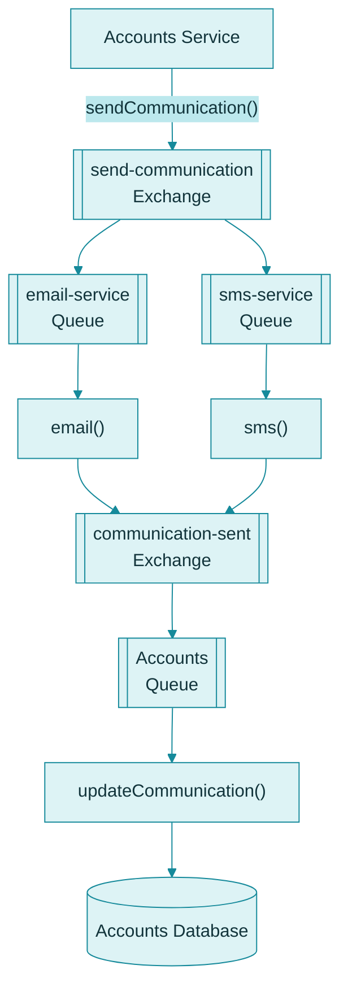
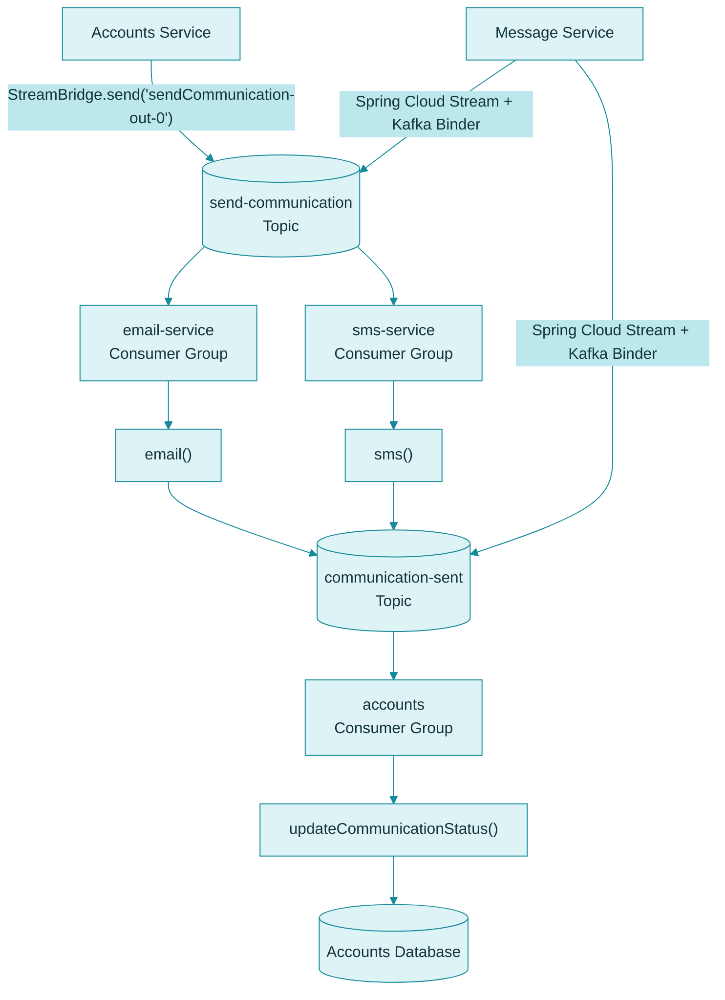

# Messaging in SammoBank: RabbitMQ vs. Kafka

This document explains the messaging model used in SammoBank, compares RabbitMQ and Apache Kafka, and documents the current Kafka-based implementation used by the application code.

SammoBank currently uses **Apache Kafka with Spring Cloud Stream** for asynchronous messaging. RabbitMQ is retained as a historical comparison and as a reference to the earlier messaging design.

## Table of Contents

- [Introduction to Messaging](#introduction-to-messaging)
- [Current SammoBank Messaging Implementation](#current-sammobank-messaging-implementation)
- [RabbitMQ vs. Kafka](#rabbitmq-vs-kafka)
- [RabbitMQ Architecture (Historical)](#rabbitmq-architecture-historical)
- [Kafka Architecture in SammoBank](#kafka-architecture-in-sammobank)
- [Understanding the Kafka Flow](#understanding-the-kafka-flow)
- [Key Differences](#key-differences)
- [Important Kafka Concepts](#important-kafka-concepts)

---

## 1. Introduction to Messaging

In a microservices architecture, services often need to communicate without waiting for another service to finish processing a request.

Asynchronous messaging allows a producer to publish a message while consumers process it independently.

In SammoBank, this pattern is used for communication events:

1. Accounts creates an account.
2. Accounts emits a communication event.
3. The Message Service processes the event.
4. Email and SMS are handled independently.
5. Result status is sent back to Accounts.
6. Accounts updates the communication status in its own database.

This pattern reduces tight coupling between services and allows independent processing.

## 2. Current SammoBank Messaging Implementation

The active implementation in this repository uses:

- Spring Cloud Stream
- Kafka Binder
- Function-based message processing
- Topics such as `send-communication` and `communication-sent`

This is visible in the project configuration and code:

- `accounts/src/main/resources/application.yml`
- `message/src/main/resources/application.yml`
- `accounts/src/main/java/com/sammo/accounts/service/impl/AccountsServiceImpl.java`
- `message/src/main/java/com/message/message/functions/MessageFunctions.java`

### Actual Flow in the Repository

The implementation is:

1. Accounts creates a customer and account.
2. Accounts emits a message to the Kafka topic `send-communication`.
3. The Message Service consumes the event.
4. The `email` function sends an email and returns a status object.
5. The `sms` function processes SMS and returns a status object.
6. Both functions publish results to `communication-sent`.
7. Accounts consumes the result event and updates communication status in the database.

This is the behavior currently implemented in the application, not just a conceptual example.

## 3. RabbitMQ vs. Kafka

RabbitMQ and Kafka both support asynchronous communication, but their messaging models differ.

| Concept | RabbitMQ | Apache Kafka |
|---|---|---|
| Main destination | Exchange | Topic |
| Consumer pattern | Queue-based | Consumer group-based |
| Initial event | `send-communication` exchange | `send-communication` topic |
| Email processing | `email-service` queue → `email()` | `email-service` consumer group → `email()` |
| SMS processing | `sms-service` queue → `sms()` | `sms-service` consumer group → `sms()` |
| Result destination | `communication-sent` exchange | `communication-sent` topic |
| Accounts processing | Accounts queue → `updateCommunication()` | Accounts consumer group → `updateCommunication()` |
| Message storage | Queue-based retention | Topic retention with partitions |
| Same message to email + SMS | Separate queues bound to exchange | Separate consumer groups reading the same topic |

The names and processing methods above describe the earlier design and general messaging concepts. The actual active implementation uses Kafka + Spring Cloud Stream and binds functions to specific topics.

### RabbitMQ

RabbitMQ is a traditional message broker that routes messages through exchanges to queues.

An exchange routes messages according to its configured type and bindings. Consumers receive messages by reading from queues.

### Apache Kafka

Kafka is a distributed event-streaming platform. Producers publish records to topics, and consumers read records from those topics.

Topics are divided into partitions. Kafka retains records according to configured retention policies, independent of whether a consumer has already processed them.

Consumer groups allow multiple services or processes to consume the same topic independently. Within a consumer group, partitions are assigned among the group members.

## 4. RabbitMQ Architecture (Historical)

The following diagram illustrates the earlier RabbitMQ design for communication processing. It is included for comparison and does not represent the current messaging implementation.

In this historical design:

1. Accounts publishes a communication request.
2. RabbitMQ routes the request to the email and SMS queues.
3. Each consumer processes its queue independently.
4. The processing result is published to the result exchange.
5. Accounts consumes the result and updates its database.

## 5. Kafka Architecture in SammoBank

The current Kafka design used by the repository uses Spring Cloud Stream function-based bindings.

### Actual Binding Names Used in Code

The current repository uses the following binding names:

- `sendCommunication-out-0`
- `updateCommunication-in-0`
- `email-in-0`
- `sms-in-0`
- `email-out-0`
- `sms-out-0`

This is aligned with the actual application configuration in:

- `accounts/src/main/resources/application.yml`
- `message/src/main/resources/application.yml`

## 6. Understanding the Kafka Flow

### Topics

A Kafka topic is a named stream of records. Producers publish records to topics, and consumers subscribe to them.

The project currently uses:

- `send-communication`
- `communication-sent`

These names match the current Spring Cloud Stream configuration and the event flow implemented in the application.

### Producers

A producer publishes records to Kafka.

In the current implementation:

- Accounts is the producer of the communication request.
- The Message Service functions produce result status events.

This is done using Spring Cloud Stream `StreamBridge` and function-based output bindings.

### Consumers and Consumer Groups

A consumer reads records from a topic.

A consumer group coordinates consumption among its members. Kafka assigns partitions to consumers within the group, so each partition is processed by one consumer in that group at a time.

Separate consumer groups can independently consume the same topic. This is how email and SMS processing can both receive the same communication event independently.

### Spring Cloud Stream Function Model

The actual implementation uses function-based bindings:

- `email()` is a Spring bean returning a `CommunicationStatusDto`.
- `sms()` is a Spring bean returning a `CommunicationStatusDto`.
- `updateCommunication` is the function name configured in the Accounts application.

This is important because the application is not using manual Kafka templates directly; it uses Spring Cloud Stream abstractions.

### Processing Results

After email or SMS processing, the result is emitted as a status object such as:

- `EMAIL_SENT`
- `EMAIL_FAILED`
- `SMS_SENT`

Accounts reads the status event and updates its internal communication status:

- `EMAIL_SENT`
- `SMS_SENT`
- `BOTH_SENT`

This logic is implemented in:

`AccountsServiceImpl.updateCommunicationStatus(...)`

### How the Code Matches the Flow

The actual flow from code is:

1. `AccountsServiceImpl.createAccount()` creates customer + account.
2. `sendCommunication()` calls `streamBridge.send("sendCommunication-out-0", accountsMsgDto)`.
3. Kafka message goes to `send-communication`.
4. Message Service consumes the message with:
    - `email-in-0`
    - `sms-in-0`
5. `MessageFunctions.email()` sends the email.
6. `MessageFunctions.sms()` simulates or emits SMS status.
7. Each function returns a `CommunicationStatusDto`.
8. Spring Cloud Stream publishes to `communication-sent`.
9. Accounts consumes `communication-sent` through:
    - `updateCommunication-in-0`
10. Accounts updates communication status in the database.

## 7. Key Differences

| Feature | RabbitMQ | Kafka |
|---|---|---|
| Core abstraction | Exchanges and queues | Topics and partitions |
| Routing | Through exchanges and bindings | Through topics and consumer groups |
| Consumer distribution | Queues deliver to one or more consumers | Consumer groups coordinate partition consumption |
| Replay | Depends on queue configuration | Records can be reread while retained |
| Message lifecycle | Typically acknowledgement/queue-based | Retention and offset tracking |
| Typical use | Task queues, broker routing | Event-driven integration, streaming, decoupled processing |

Neither technology is universally better. The right choice depends on routing requirements, retention policies, replay, throughput, and operational semantics.

## 8. Important Kafka Concepts

- **Broker:** A Kafka server that stores and serves topic partitions.
- **Topic:** A named stream of records.
- **Partition:** An ordered sequence of records within a topic.
- **Producer:** An application that publishes records.
- **Consumer:** An application that reads records.
- **Consumer Group:** A group of consumers that share partition assignments.
- **Offset:** Position of a record within a partition.
- **Retention:** How long Kafka keeps records before cleanup.
- **Serialization:** Conversion of Java objects to a wire format for Kafka.

## Notes for This Project

The original messaging design is useful for learning, but the actual repository behavior should be treated as the source of truth.

The project is currently aligned with:

- Kafka
- Spring Cloud Stream
- Function-based message processing
- `send-communication` request topic
- `communication-sent` status topic
- `email-service` and `sms-service` consumer groups

---
