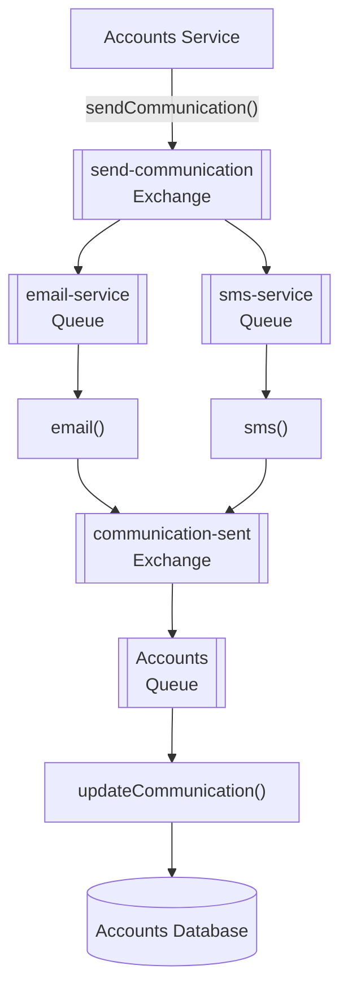
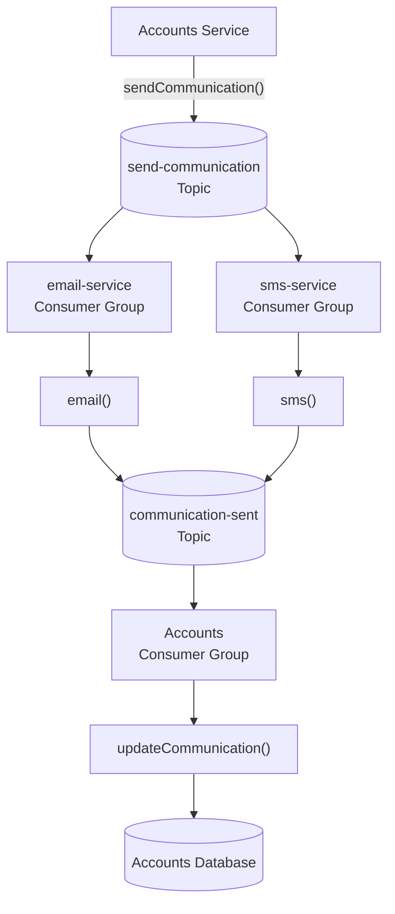

# Messaging in SammoBank: RabbitMQ vs. Kafka

This document explains asynchronous messaging concepts, compares RabbitMQ and Apache Kafka, and illustrates how communication events flow through SammoBank.

SammoBank uses **Apache Kafka** for asynchronous messaging. RabbitMQ is included for comparison with the earlier messaging design.

## Table of Contents

- [Introduction to Messaging](#introduction-to-messaging)
- [RabbitMQ vs. Kafka](#rabbitmq-vs-kafka)
- [RabbitMQ Architecture (Historical)](#rabbitmq-architecture-historical)
- [Kafka Architecture in SammoBank](#kafka-architecture-in-sammobank)
- [Understanding the Kafka Flow](#understanding-the-kafka-flow)
- [Key Differences](#key-differences)
- [Important Kafka Concepts](#important-kafka-concepts)

## Introduction to Messaging

In a microservices architecture, services often need to communicate without waiting for another service to finish processing a request.

**Asynchronous messaging** allows a producer to publish a message while consumers process it independently.

For example, when an account-related operation triggers a communication event, email and SMS processing can happen independently. Once the communication result is available, Accounts can process the result and update its database.

This approach helps reduce direct dependencies between services and allows independent message processing.

## RabbitMQ vs. Kafka

RabbitMQ and Kafka both support asynchronous communication, but their messaging models differ.

| Concept | RabbitMQ | Apache Kafka |
|---|---|---|
| Main destination | **Exchange** | **Topic** |
| Consumers receive through | **Queues** | **Consumer Groups** |
| Initial destination | `send-communication` exchange | `send-communication` topic |
| Email processing | `email-service` queue → `email()` | `email-service` consumer group → `email()` |
| SMS processing | `sms-service` queue → `sms()` | `sms-service` consumer group → `sms()` |
| Result destination | `communication-sent` exchange | `communication-sent` topic |
| Accounts processing | Accounts queue → `updateCommunication()` | Accounts consumer group → `updateCommunication()` |
| Message storage | Queue-based delivery, subject to queue and message configuration | Messages retained in topic partitions according to retention settings |
| Delivering the same message to email and SMS | Separate queues bound to an exchange | Separate consumer groups subscribe to the same topic |

The names and processing methods in this table describe the messaging design from the original project documentation. Verify them against the current implementation before treating every name as an active Kafka topic, consumer group, or method.

### RabbitMQ

RabbitMQ is a traditional message broker that routes messages through exchanges to queues.

An exchange routes messages according to its configured exchange type and bindings. Consumers receive messages from queues.

### Apache Kafka

Kafka is a distributed event-streaming platform. Producers publish records to topics, and consumers read records from those topics.

Topics are divided into partitions. Kafka retains records according to its configured retention policies, independently of whether a consumer has already processed them.

Consumer groups allow applications to read topics independently. Within a consumer group, partitions are assigned among the group's consumers.

## RabbitMQ Architecture (Historical)

The following diagram illustrates the earlier RabbitMQ design for communication processing. It is included for comparison and does not represent the current messaging implementation.

In this design:

1. Accounts publishes a communication request.
2. RabbitMQ routes the request to the email and SMS queues.
3. Each consumer processes its queue independently.
4. The processing result is published to the result exchange.
5. Accounts consumes the result and updates its database.

## Kafka Architecture in SammoBank

The Kafka design uses topics and consumer groups to distribute communication events to independent consumers.

**Important:** This diagram represents the event flow described in the original README. The exact topic names, consumer groups, producers, and result-publishing behavior must be confirmed against the current code and Kafka configuration.

### How the Kafka Flow Works

1. **Publish the request:** Accounts publishes a communication event to the `send-communication` topic.
2. **Process email:** The email consumer group reads the event and invokes the email-processing logic.
3. **Process SMS:** The SMS consumer group independently reads the event and invokes the SMS-processing logic.
4. **Publish the result:** The processing components publish communication results to the `communication-sent` topic, if configured to do so.
5. **Consume the result:** The Accounts consumer group reads the result event.
6. **Update the database:** Accounts processes the result using the `updateCommunication()` logic and updates its database.

Because email and SMS use separate consumer groups, both groups can receive their own copy of each eligible topic record. They do not compete with each other for a single copy in the way consumers within the same group do.

The diagram assumes both processing paths publish results. If the implementation publishes only one result or uses a different result-handling design, update the diagram accordingly.

## Understanding the Kafka Flow

### Topics

A topic is a named stream of records. Producers publish records to topics, and consumers subscribe to them.

The original SammoBank design identifies these topics:

- `send-communication`
- `communication-sent`

### Producers

A producer publishes records to Kafka.

In the documented flow, Accounts is the producer of communication requests. The email and SMS processing components may produce result events, depending on the implementation.

### Consumers and Consumer Groups

A consumer reads records from a topic.

A consumer group coordinates consumption among its members. Kafka assigns topic partitions to consumers within the same group, so each partition is generally processed by one consumer in that group at a time.

Separate consumer groups can independently consume the same topic. This is what allows email and SMS processing to receive the same communication event independently.

### Partitions and Retention

Kafka topics can have multiple partitions, allowing parallel processing and distributing data across brokers.

Kafka retains records according to topic and broker retention settings. Records are not necessarily deleted immediately after a consumer processes them.

This differs from the typical queue-based processing model, where a successfully acknowledged message may be removed from a queue.

### Processing Results

A result event can indicate that communication processing has completed or provide information about its outcome.

Accounts can consume these results and update its own database. The exact result schema, delivery guarantees, and error-handling strategy depend on the implementation.

## Key Differences

| Feature | RabbitMQ | Kafka |
|---|---|---|
| Core abstraction | Exchanges and queues | Topics and partitions |
| Routing | Exchanges, bindings, and routing rules | Topic and partition selection, with optional keys |
| Consumer distribution | Consumers receive messages from queues | Consumer groups coordinate partition consumption |
| Replay | Depends on queue and broker configuration | Records can be reread while retained |
| Message lifecycle | Often queue/acknowledgement-oriented | Retention and consumer offsets |
| Common use cases | Task queues and broker-based routing | Event streaming, event-driven systems, and data pipelines |

Neither technology is universally better. The right choice depends on routing requirements, retention, replay, throughput, delivery semantics, and operational needs.

## Important Kafka Concepts

- **Broker:** A Kafka server that stores and serves topic partitions.
- **Topic:** A named stream of records.
- **Partition:** An ordered sequence of records within a topic.
- **Producer:** An application that publishes records.
- **Consumer:** An application that reads records.
- **Consumer group:** A group of consumers that share partition assignments.
- **Offset:** A record's position within a partition, used to track consumption progress.
- **Retention:** The policy that determines how long Kafka keeps records.
- **Serialization:** Converting application objects into a format suitable for publishing and reading records.

---

For local startup instructions, see [Project Setup](project-setup.md). For security and access-token configuration, see [Keycloak Security](keycloak-security.md).