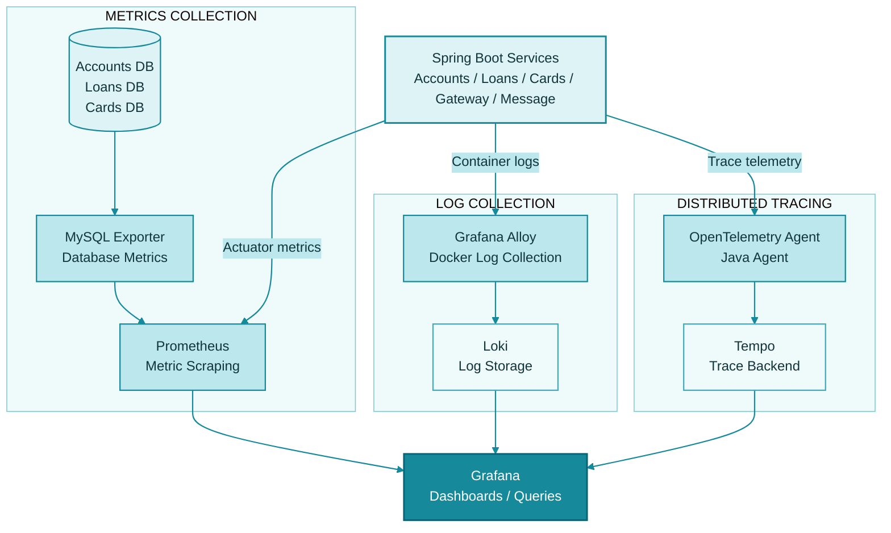

# Observability in SammoBank

SammoBank uses a layered observability stack to collect logs, metrics, and traces from application services and infrastructure.

The current implementation is aligned with the Docker Compose setup in `docker-compose/default/docker-compose.yml` and the shared service configuration in `docker-compose/default/common-config.yml`.

This document reflects the active repository setup, not just the original conceptual design.

## Table of Contents

- [Current Implementation](#1-current-implementation)
- [Observed Data Flow](#2-observed-data-flow)
- [Component Responsibilities](#3-component-responsibilities)
- [Logs: Alloy and Loki](#4-logs-alloy-and-loki)
- [Metrics: Prometheus and MySQL Exporter](#5-metrics-prometheus-and-mysql-exporter)
- [Traces: OpenTelemetry and Tempo](#6-traces-opentelemetry-and-tempo)
- [Repository Locations](#7-repository-locations)
- [Troubleshooting Checklist](#8-troubleshooting-checklist)
- [Summary](#9-summary)

---

## 1. Current Implementation

The current implementation uses the following observability pattern:

- **Logs:** Collected by Grafana Alloy from Docker containers.
- **Log Storage:** Logs are forwarded to Loki.
- **Metrics:** Prometheus scrapes application metrics and MySQL Exporter metrics.
- **Database Monitoring:** MySQL Exporter monitors the Accounts, Loans, and Cards databases.
- **Distributed Tracing:** Spring Boot services run with the Java OpenTelemetry agent.
- **Trace Storage:** OpenTelemetry traces are exported to Grafana Tempo.
- **Visualization:** Grafana queries Loki, Prometheus, and Tempo.

This implementation is configured through:

- `docker-compose/default/docker-compose.yml`
- `docker-compose/default/common-config.yml`

### Important Runtime Configuration

The shared configuration includes the following OpenTelemetry environment variables:

```yaml
JAVA_TOOL_OPTIONS: "-javaagent:/app/libs/opentelemetry-javaagent-2.22.0.jar"
OTEL_EXPORTER_OTLP_ENDPOINT: "http://tempo:4318"
OTEL_METRICS_EXPORTER: "none"
OTEL_LOGS_EXPORTER: "none"
```

This means the default project setup is primarily trace-oriented via OpenTelemetry, while:

- Logs are handled by Alloy and Loki.
- Metrics are handled by Prometheus and MySQL Exporter.

Application metrics are collected separately through the configured application endpoints.

## 2. Observed Data Flow

The following diagram represents the observability architecture currently configured in the repository.



This represents the three observability pipelines:

1. **Logs:** Application containers → Alloy → Loki → Grafana.
2. **Metrics:** Application endpoints and MySQL Exporter → Prometheus → Grafana.
3. **Traces:** Spring Boot applications → OpenTelemetry Java Agent → Tempo → Grafana.

## 3. Component Responsibilities

| Component | Responsibility |
|---|---|
| Grafana Alloy | Collects container logs and forwards them to Loki |
| Loki | Stores and queries logs |
| Prometheus | Scrapes metrics from application endpoints and exporters |
| MySQL Exporter | Exposes MySQL database metrics in Prometheus format |
| OpenTelemetry Java Agent | Sends trace telemetry from Java services to Tempo |
| Tempo | Stores and queries traces |
| Grafana | Visualizes logs, metrics, and traces across the stack |

## 4. Logs: Alloy and Loki

The current Compose setup includes the following observability services:

- `alloy`
- `read`
- `write`
- `backend`
- `gateway`
- `minio`

It also includes Loki-related configuration files under:

`docker-compose/observability/`

The repository uses Grafana Alloy to collect Docker container logs. The logs are then routed through the Loki pipeline and made available in Grafana.

### Log Collection Flow

```text
Application Containers
        |
        v
   Grafana Alloy
        |
        v
       Loki
        |
        v
      Grafana
```

### What to Verify When Troubleshooting Logs

- Alloy configuration is correct and mounted into the container.
- Docker socket access is available.
- Target services are producing logs to stdout/stderr.
- Loki read/write configuration is healthy.
- Grafana is connected to Loki as a data source.

## 5. Metrics: Prometheus and MySQL Exporter

Metrics are collected through Prometheus and MySQL Exporter.

The repository includes:

- Prometheus container.
- MySQL Exporter container.
- MySQL database services:
    - `accountsdb`
    - `loansdb`
    - `cardsdb`

The exporter is configured to query the MySQL databases and expose metrics in Prometheus format.

Prometheus then scrapes those endpoints and provides the data to Grafana.

### Metrics Collection Flow

```text
MySQL Databases
       |
       v
 MySQL Exporter
       |
       v
   Prometheus
       |
       v
    Grafana
```

Application metrics are collected separately:

```text
Spring Boot Actuator Endpoints
              |
              v
          Prometheus
              |
              v
           Grafana
```

### What to Verify When Troubleshooting Metrics

- Check the Prometheus scrape targets.
- Verify the exporter is running and reachable.
- Confirm database credentials in the exporter configuration are valid.
- Confirm the Spring Boot applications are exposing Actuator metrics.
- Review the Grafana Prometheus data source configuration.

## 6. Traces: OpenTelemetry and Tempo

The active trace path in this repository is based on the Java OpenTelemetry agent.

The shared configuration contains:

```yaml
JAVA_TOOL_OPTIONS: "-javaagent:/app/libs/opentelemetry-javaagent-2.22.0.jar"
OTEL_EXPORTER_OTLP_ENDPOINT: "http://tempo:4318"
OTEL_METRICS_EXPORTER: "none"
OTEL_LOGS_EXPORTER: "none"
```

This indicates that the default local setup is primarily configured for tracing, not metrics or logs through OpenTelemetry.

### Trace Collection Flow

```text
Spring Boot Application
          |
          v
 OpenTelemetry Java Agent
          |
          v
         Tempo
          |
          v
        Grafana
```

### What to Verify When Troubleshooting Traces

- Confirm the Java agent is present in the runtime image.
- Check that the service can reach `tempo:4318`.
- Check Grafana Tempo data source configuration.
- Verify the application is started with the expected OpenTelemetry environment variables.
- Make sure the relevant services are instrumented and generating spans.

## 7. Repository Locations

The main observability resources in this repository are:

### Docker Compose

- `docker-compose/default/docker-compose.yml`
- `docker-compose/default/common-config.yml`
- `docker-compose/observability/`

### Helm Charts

- `helm/grafana/`
- `helm/grafana-alloy/`
- `helm/grafana-loki/`
- `helm/grafana-tempo/`
- `helm/kube-prometheus/`
- `helm/mysql-exporter/`

These paths correspond to the repository's local Docker setup and Helm deployment assets.

## 8. Troubleshooting Checklist

### Logs Missing in Grafana / Loki

Check:

- [ ] Alloy is running.
- [ ] Docker socket is mounted correctly.
- [ ] Loki read/write services are healthy.
- [ ] Grafana data source points to Loki.
- [ ] Relevant application containers are emitting logs.

### Metrics Missing in Grafana / Prometheus

Check:

- [ ] Prometheus targets are up.
- [ ] Actuator metrics endpoints are enabled.
- [ ] MySQL Exporter is reachable.
- [ ] Exporter credentials and database settings are valid.
- [ ] Grafana data source is configured for Prometheus.

### Traces Missing in Tempo / Grafana

Check:

- [ ] OpenTelemetry Java agent is present.
- [ ] `OTEL_EXPORTER_OTLP_ENDPOINT` is correct.
- [ ] Tempo is listening on the expected OTLP endpoint.
- [ ] The service is not overriding the endpoint.
- [ ] Grafana is configured to read Tempo as a data source.

## 9. Summary

The repository's current observability implementation can be summarized as follows:

| Observability Signal | Collection | Storage | Visualization |
|---|---|---|---|
| Logs | Grafana Alloy | Loki | Grafana |
| Metrics | Prometheus + MySQL Exporter | Prometheus | Grafana |
| Traces | OpenTelemetry Java Agent | Tempo | Grafana |

Together, these components provide centralized visibility into application logs, infrastructure and database metrics, and distributed traces across the SammoBank microservices environment.

---