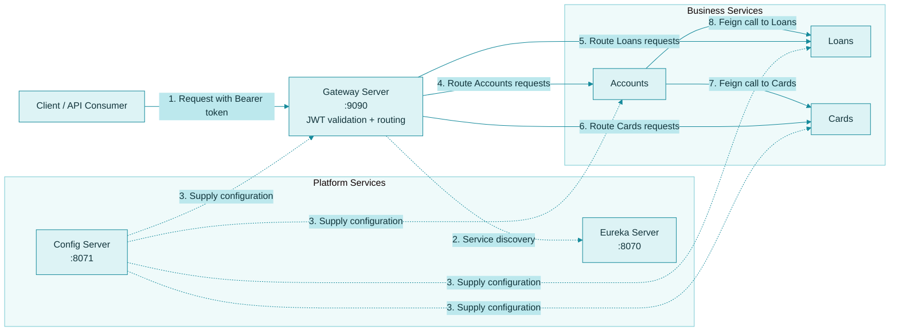
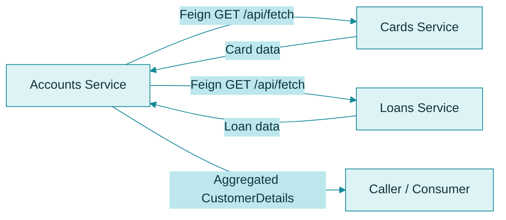
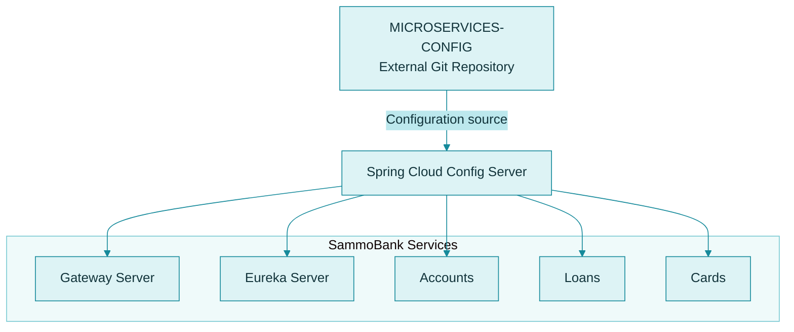
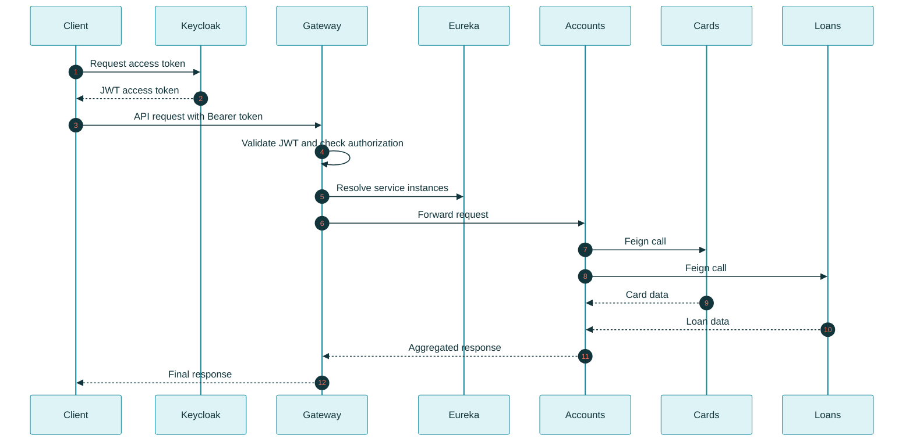

# Service Discovery and Gateway Server

This document describes the service discovery and API gateway architecture currently implemented in SammoBank. It covers Eureka, Spring Cloud Gateway, Spring Cloud LoadBalancer, OpenFeign, Config Server integration, JWT validation, and request correlation.

## 1. Current Architecture

SammoBank uses the following components:

- **Eureka Server** – Service registry for registering and discovering service instances.
- **Spring Cloud Gateway** – Central entry point for incoming API requests.
- **Spring Cloud LoadBalancer** – Client-side load balancing and service instance resolution.
- **OpenFeign** – Declarative inter-service communication.
- **Config Server** – Centralized external configuration management.

### Architecture Overview



The diagram represents the project's current implementation:

- Gateway routes are defined in `GatewayConfig.java`.
- JWT validation and authorization are configured in `SecurityConfig.java`.
- Correlation IDs are handled by `RequestTraceFilter.java` and `ResponseTraceFilter.java`.
- Accounts uses Feign clients to communicate with Cards and Loans.

## 2. Eureka Service Discovery

SammoBank uses **Netflix Eureka Server** as its service registry. Instead of relying on hardcoded IP addresses and ports, services register themselves with Eureka and can be discovered using their application names.

### Current Configuration

| Component | Port |
|---|---:|
| Eureka Server | 8070 |
| Gateway Server | 9090 |

### How Service Discovery Works

1. A microservice starts and registers itself with Eureka.
2. Eureka maintains a registry of available service instances.
3. Other services discover registered instances using their application names.
4. Spring Cloud LoadBalancer and Feign use the discovered service information to communicate with the target service.

The application names used in the project include:

- `accounts`
- `loans`
- `cards`
- `gatewayserver`

Service registration and discovery are controlled through each application's Spring Cloud configuration and Eureka client settings.

## 3. Spring Cloud Gateway

Spring Cloud Gateway acts as the **single entry point for external API traffic** in SammoBank.

The Gateway is responsible for:

- Accepting incoming client requests.
- Validating JWT access tokens.
- Enforcing role-based authorization.
- Routing requests to the appropriate downstream microservice.
- Using service discovery to resolve downstream services.
- Maintaining correlation IDs across the request chain.
- Returning downstream responses to the client.

### Configured Routes

The Gateway currently handles the following API routes:

| Route | Target Service |
|---|---|
| `/sammobank/accounts/**` | Accounts |
| `/sammobank/loans/**` | Loans |
| `/sammobank/cards/**` | Cards |

### Important Implementation Files

| Responsibility | File |
|---|---|
| Gateway route configuration | `gatewayserver/src/main/java/com/sammo/gatewayserver/config/GatewayConfig.java` |
| JWT validation and authorization | `gatewayserver/src/main/java/com/sammo/gatewayserver/config/SecurityConfig.java` |
| Request correlation filter | `gatewayserver/src/main/java/com/sammo/gatewayserver/filters/RequestTraceFilter.java` |
| Response correlation filter | `gatewayserver/src/main/java/com/sammo/gatewayserver/filters/ResponseTraceFilter.java` |

### Gateway Request Processing

A typical request follows this sequence:

1. The client sends an API request with a Bearer token.
2. Spring Security validates the JWT.
3. Authorization rules check whether the authenticated user has the required authority.
4. The Gateway resolves the downstream service.
5. The request is forwarded to the appropriate microservice.
6. Correlation information is propagated through the request chain.
7. The downstream response is returned to the client.

## 4. OpenFeign Inter-Service Communication

SammoBank uses **Spring Cloud OpenFeign** for declarative communication between microservices.

The Accounts service aggregates customer information by calling the Cards and Loans services through Feign clients.

### Implementation Files

```text
accounts/
└── src/main/java/com/sammo/accounts/
    ├── service/
    │   ├── client/
    │   │   ├── CardsFeignClient.java
    │   │   └── LoansFeignClient.java
    │   └── impl/
    │       └── CustomersServiceImpl.java
```

### Communication Flow



The Feign clients use service names rather than hardcoded service addresses.

For example:

```java
@FeignClient(name = "cards", fallback = CardsFallback.class)
```

```java
@FeignClient(name = "loans", fallback = LoansFallback.class)
```

The fallback implementations provide the configured fallback behavior when downstream communication fails.

### Correlation ID Propagation

The request also carries a correlation ID through the following header:

```text
sammobank-correlation-id
```

The Accounts service forwards this header when making downstream Feign calls. This helps trace a request across multiple microservices and makes troubleshooting distributed requests easier.

## 5. Config Server Relationship

SammoBank uses Spring Cloud Config Server to centralize application configuration in an external Git repository.

The configuration repository is:

[**MICROSERVICES-CONFIG**](https://github.com/SoyaChunkz/MICROSERVICES-CONFIG)

### Configuration Flow



The Config Server retrieves configuration from the external repository and makes it available to the microservices.

The repository includes the Config Server module and its Docker Compose configuration:

```text
configserver/
docker-compose/default/docker-compose.yml
```

The current Compose setup expects services to retrieve their configuration from Config Server during startup.

## 6. Documented Service Ports

The following ports are documented for the current SammoBank setup:

| Component | Port |
|---|---:|
| Config Server | 8071 |
| Eureka Server | 8070 |
| Gateway Server | 9090 |
| Accounts | 8080 |
| Loans | 8090 |
| Cards | 9000 |

These are the documented application ports. Container networking and deployment-specific configuration may determine how services communicate in different environments.

## 7. End-to-End Request Flow

The following sequence illustrates how a request travels through SammoBank, from authentication to the final aggregated response.



### Request Lifecycle

1. The client authenticates with Keycloak and obtains a JWT access token.
2. The client sends an API request to the Gateway with the Bearer token.
3. The Gateway validates the token and checks the required authorization.
4. The Gateway resolves the target service through service discovery.
5. The request is forwarded to the Accounts service.
6. Accounts calls Cards and Loans through OpenFeign.
7. The downstream services return their respective data.
8. Accounts aggregates the information into a `CustomerDetails` response.
9. The Gateway returns the final response to the client.

## 8. Troubleshooting

### Service Does Not Appear in Eureka

- Check the service's Eureka client configuration.
- Review the service startup logs.
- Verify network connectivity and hostname configuration.
- Confirm that the service is registering with the expected application name.
- Ensure Eureka Server is available.

### Gateway Cannot Route to a Service

- Check the route definitions in `GatewayConfig.java`.
- Verify the target service name.
- Confirm that the downstream service is registered with Eureka.
- Check whether the downstream service is healthy.
- Verify that Gateway security rules are not blocking the request.
- Review Gateway startup logs for routing or discovery errors.

### Feign Call Fails

- Verify the Feign client service name.
- Check that the downstream service is registered with Eureka.
- Verify the downstream endpoint and request path.
- Check correlation ID and request headers.
- Review the corresponding fallback implementation.
- Inspect the Accounts and downstream service logs.

### JWT Validation Fails

- Verify the token issuer.
- Check the Keycloak realm and JWK endpoint.
- Confirm the role mapping from `realm_access.roles`.
- Ensure Gateway authorization rules match the roles present in the token.
- Check that the token has not expired.

### Works Locally but Not in Containers

- Inspect hostnames such as `localhost`, `keycloak`, `configserver`, and `eurekaserver`.
- Remember that `localhost` inside a container refers to that container itself.
- Ensure Docker networking is configured correctly.
- Verify that the relevant service names resolve inside the Compose network.
- Check that service URLs use the correct container ports.

## 9. Summary

| Component | Responsibility |
|---|---|
| Eureka Server | Service registration and discovery |
| Spring Cloud Gateway | Central API entry point and request routing |
| Spring Cloud LoadBalancer | Service instance resolution and client-side load balancing |
| OpenFeign | Declarative inter-service communication |
| Config Server | Centralized external configuration |
| Keycloak | Authentication and JWT token issuance |
| Spring Security | JWT validation and authorization |
| Correlation ID | Request tracing across microservices |

Together, these components provide SammoBank with centralized API routing, service discovery, distributed communication, externalized configuration, and request-level traceability.

---
